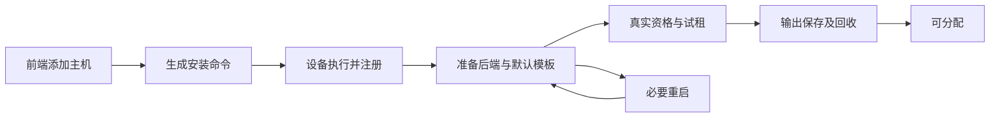

# 家庭计算节点正式交付核查

2026-11-05。首发范围是家庭局域网或已有 VPN：前端添加 Mac / Windows 主机，生成一次执行命令，自动完成 Agent、虚拟化后端和默认模板准备；必要时重启并继续原安装，最终完成可租用验证。不是“复制配对信息后继续人工配置”。互联网异地组网、云计费和 Vesta Windows 全应用不属于这次范围。

## 已完成及本轮修正

- Docker / Portainer 的既有真实容器、存储、SSH、续租和回收证据保留；不因本次核查重跑。
- Tart macOS / Ubuntu ARM、Hyper-V Windows x64 的真实资格、验证发布、租客访问和回收均有既有证据。Ubuntu ARM 的 Vesta / Prism 服务启停及重启数据保留已通过。
- Windows 默认模板已改为 guest 管理员：原准备 VM 的 `workspace` 加入 Administrators，重新导出、封存、真实克隆并经 SSH 验证管理员 token 和 System32 临时文件写入/删除；正常镜像验证和发布成功。旧普通用户导出已移除，不再作为可选模板保留。
- 新模板 `windows11-pro-node24-amd64` 的摘要为 `sha256:99a7c43b59b8c3a669075bb5d85e8f360a5d2aaab4d41dcffaedd6372184ddd0`；本次发布 version `42f35ac7-8fdd-467d-814f-bfec83f432cb`，validation `53891d08-a355-42f6-9f57-3a3f6857fa6d` 为 passed / cleanup complete。历史 ID 不是常驻在线目录。
- 当前消费者要求是 Windows CLI 验收，不要求 Vesta 在原生 Windows 上运行全套应用。原 Temporal 观察改记为“core-bridge 原生加载未就绪，底层错误未留存，根因未定”；不判定为上游不支持、Hitchlet 环境不足或管理员权限不足，也不再作为 CLI 放行条件。
- 两个 Windows CLI 取消用例的原失败保留。其断言包含 POSIX 信号处理假设；管理员模板变更不自动使 Windows 获得该语义，不能倒写原结果或声称取消已修复。

Temporal 1.17.1 的固定源码列出 Windows x64 MSVC 目标，同版本 CI 包含 Windows x64 / Node 24。依据：[平台映射](https://github.com/temporalio/sdk-typescript/blob/v1.17.1/packages/core-bridge/common.js)、[固定版本 CI](https://github.com/temporalio/sdk-typescript/blob/v1.17.1/.github/workflows/ci.yml)。这些依据不替代 Vesta 的应用支持范围，也不把未就绪观察改成加载成功。

## 新主机全自动接入：当前缺口

现有底层足以继续实现，但当前版本还不能按上述新范围宣称正式上线。以下结论来自当前源码及实际使用链路；不能用“已有配对 API”替代完整安装。

| 必须补齐的连接       | 当前实际情况                                                                                                     | 本轮上线需要的结果                                                                                                  |
| -------------------- | ---------------------------------------------------------------------------------------------------------------- | ------------------------------------------------------------------------------------------------------------------- |
| 前端添加主机         | `InventorySetup` 主要是 Portainer / Machine / Node 分步表单；Host 配对仍需已知 Machine、Host identity 和配置文件 | 选择 Mac / Windows，显示默认预算与管理员模板，生成可执行命令；无需手抄内部 ID 或 secret ref                         |
| 可安装发行包         | `package-runtime.mjs` 只离线组包，不含 Node、安装器、后端或默认模板                                              | 固定版本、摘要可核验的发行包和模板来源；设备自动安装所需组件，复用已符合版本的组件                                  |
| 初次注册与常驻       | Host 有单次配对、心跳、会话 fencing；Runtime 有认证入口，但启动依赖手工配置，未交付统一系统服务安装器            | 自动注册身份、保存专用认证、启动 Host / Runtime；重启后持续运行，失败显示具体阶段                                   |
| 后端及默认模板       | 已有 Tart / Hyper-V 驱动、初始化和封存，真实准备目前由脚本人工编排                                               | 自动探测、安装或启用后端，取得默认模板并封存；Windows 必要重启后续接，Mac 保持与用户会话/Keychain要求兼容           |
| 跨机访问             | Hyper-V 现有 SSH relay 绑定控制器 loopback，依赖维护 SSH；Tart 测试主要在同一 Studio 上完成                      | 新节点加入后，控制器和目标消费者都能取得实际可达的 SSH 通道；不得沿用本机 loopback 冒充 LAN / VPN 可达              |
| 一次完整准入         | 发现、登记、Runtime 配置、资格、验证发布分别存在，GUI 的镜像准备仍以 Docker 为主                                 | 自动串起同一主机的这些步骤；先完成真实小型试租与回收，再显示“可分配”                                                |
| 稳定运行             | 周期 Runtime facts 刷新与资格证据有效期分开；VM 目前采用固定人工预算，`observed_host` 提升逻辑限于 Portainer     | 自动接入要使用实际主机观测与共享预算；资格过期/变化应能自动处理，不能只装好后靠人定期重做，也不能仅刷新时间冒充复验 |
| 升级、失败恢复、移除 | Ticket 的恢复/回收已实现；新安装流程没有统一持久检查点与升级卸载入口                                             | 网络中断和重启继续原安装，不重复注册；更新失败可恢复；移除节点先停止新分配、清理已有租用，再卸载专属组件            |

代码定位：`apps/gui/src/InventorySetup.tsx`、`ImageSetup.tsx`；`apps/runtime-agent/src/host-main.ts`、`tart-main.ts`、`hyperv-main.ts`；`apps/controller/src/providers/hyperv-ssh-relay.ts`；`apps/controller/src/domain/attested-capability.ts`；`apps/controller/src/application/admin.ts`；`scripts/package-runtime.mjs`。

这些是一个“新主机到可租用”的交付链，不拆成相互阻断的新产品或通用工作流框架。复用现有身份、账本、Provider 和验证接口；不另造第二套租约或调度器。

## 全自动的验收口径

只做两条真实新接入样本：一台 Mac ARM、一台 Windows x64。各自从未接入状态运行一次命令，核实前端阶段、主机身份、实际容量、默认模板、跨机访问、租用/归还和专属服务重启恢复。中断恢复沿原安装 ID；已安装软件、已下载且摘要未变的包和模板复用。业务输入未变的 Vesta / Prism 套件不再重跑，平台试租使用小型合成任务即可。

安装命令可以请求这台设备正常的管理员授权及必要重启；不使用平台管理员 token 作长期 Agent 凭据。Windows 家庭版、无虚拟化硬件等真实不支持条件要明确显示，不能靠自动安装伪造能力。默认管理员权限限于租客 VM；直接容器的 `Privileged:false` 边界保留。

## 推进顺序与后置项

1. 先打通前端命令、发行包、设备注册、常驻和重启续接；同一流程实现后端/模板自动准备。
2. 接通跨机 Runtime / SSH、真实资格与试租回收，完成 Mac / Windows 两个新节点样本。
3. 收敛为一个实际常驻部署的混合目录，确认同一物理主机的共享容量不重复计算、失联停止新增分配、已有租用可恢复；再更新版本和发布回执。

Windows 差分盘/快照池、互联网穿透、macOS 或 Linux x64 的新业务矩阵、付费模型、云扩容不加入这条上线主线。备份恢复、凭据轮换等已有能力复用有效证据；只有自动安装或实际部署改动影响到的连接需要定向验证。没有明确结算需求，不引入计费账本；这里的节点分配指计算资源。

Windows 模板更新已收口；全自动新节点接入尚未实现。该核查记录定义实际剩余工作，不是全自动功能的通过证明。
