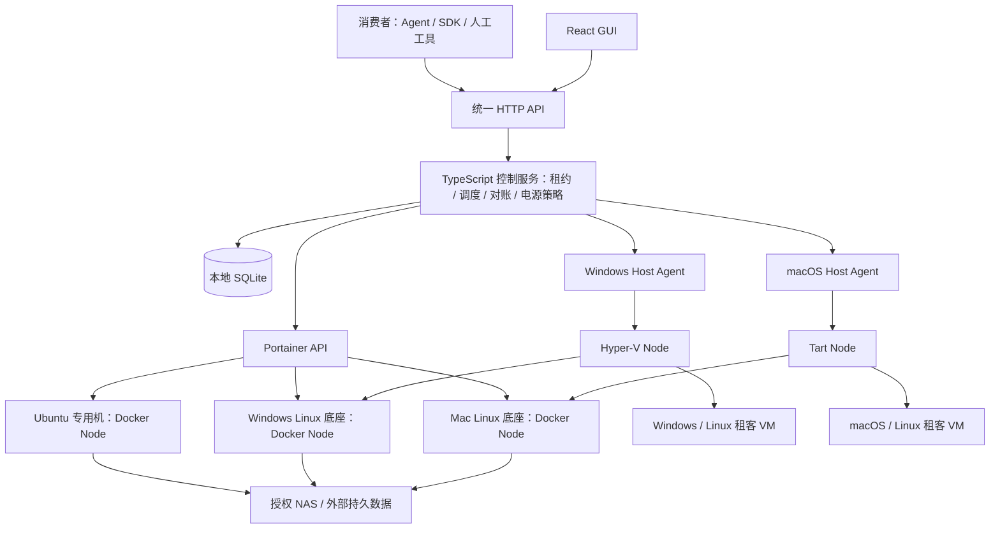
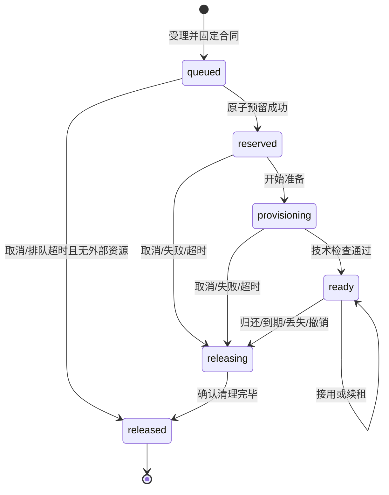

# 独立计算资源租用系统：架构与开发设计

版本：1.3｜日期：2026-10-19｜状态：经整体复核的开发基线，尚未实现或通过实机验收。

本系统以 Ticket 为入口，向消费者按需交付隔离的容器或虚拟机，负责资源预留、环境准备、续租、回收，以及机器的人机共用和节能策略。它可以独立于 OpenClaw 部署。Agent、开发工具、媒体处理程序和人工使用者均是消费者；调度器不理解它们的业务。

架构兼容 **Portainer、Hyper-V、Tart 三个后端**，开发顺序明确为 **Docker 优先，VM 按实际需求后置**。当前交付目标是 Portainer Docker 的独立生产闭环，Hyper-V/Tart 不作为其上线前提。控制服务、宿主代理和 GUI 的自研部分使用 **TypeScript**；控制数据使用本地 **SQLite**。未来专用计算机优先安装 Ubuntu，直接提供 Docker。Windows 和 Mac 保留原生系统；需要 VM 时再分别启用 Hyper-V、Tart，也可用它们提供受管 Linux Docker 底座。

本目录是独立的设计交付包：

| 文件 | 用途 |
| --- | --- |
| [README.md](README.md) | 需求、领域边界、行为合同、模块接口、异常处理、GUI、开发任务和验收标准；可独立阅读 |
| [contracts.ts](contracts.ts) | TypeScript 总索引；具体合同按公开 DTO、内部模型、服务、Provider 与 Agent 分模块，不包含运行实现 |
| [contracts/README.md](contracts/README.md) | 接口分层、默认值、调用约定、设计取舍和v1.1迁移说明；消费者从[public.ts](contracts/public.ts)开始 |
| [contracts/usage.examples.ts](contracts/usage.examples.ts) | 简洁 SDK 的申请、接用、续租与明确归还示例，仅作编译校验 |
| [contracts/contracts.typecheck.ts](contracts/contracts.typecheck.ts) | 编译期边界回归：公开字段、互斥状态、运行时身份及命令/结果关联 |
| [schema.sql](schema.sql) | 可执行的 SQLite 初始数据模型；迁移和跨表工作流约束仍需按本文实现 |
| [verify-schema.cjs](verify-schema.cjs) | 用临时数据库重复验证DDL、关键约束和示例记账事务；只依赖Node与sqlite3命令 |
| [VERIFICATION.md](VERIFICATION.md) | 本次设计交付的校验方法、结果和未覆盖范围 |

正文规定行为；接口骨架和建表草案为实现起点。开发时用同一份运行时 Schema 生成 OpenAPI、SDK 类型与契约测试，避免长期维护三个互相漂移的定义。本文的超时、额度和性能数字是**设计默认或容量估算**，不是已实测的设备能力。文中 v1 指协议与行为基线，具体在哪个发布阶段实现以第19节为准；VM设计先保留，不要求当前编码。

`siteId` 是安装内逻辑键，默认值为 `local`；也可使用管理员登记的非空字符串。它不代表独立 Site 实体或 UUID。

## 1. 目标、边界与交付范围

### 1.1 必须完成的使用闭环

1. 管理员登记机器、后端入口、容量、镜像、网络/存储授权以及人机共用策略。
2. 消费者提交镜像、硬件规格、架构和放置约束，获得持久化 Ticket。
3. 系统筛选资源并原子预留；必要时唤醒机器、启动底座、准备镜像，创建独立租客环境。
4. 环境通过技术就绪检查，Ticket 变为 ready；消费者确认接用并领取连接材料。
5. 消费者自行执行工作、定期续租，将需要保留的数据保存到授权外存。
6. 消费者归还，或租约到期；系统撤销访问、停止环境、清理自有资源，确认后释放容量。
7. 机器持续无人使用、无租客、无维护和未决操作，才按策略进入节能流程。后续申请可触发已验证的唤醒路径。

### 1.2 能力范围

| 要求 | 本版合同 |
| --- | --- |
| 业务独立 | 不含媒体、下载、构建任务表；不读取 OpenClaw 配置才能启动；`clientRef` 仅是不透明关联字段 |
| 隔离申请 | 一张 Ticket 在 v1 对应一个主容器或一个租客 VM；独立工作区、身份、访问材料和资源清单 |
| 镜像复用 | 可复用不可变模板、受控缓存和平台 Linux 底座；不能复用上一租客的可写环境 |
| 资源限制 | CPU/内存有明确预算与实施方式；临时盘硬限制、设备和强网络隔离只在验证支持时承诺 |
| 人机共用 | 人的登录和未知状态阻止自动关机；人的使用可阻止新增重任务，不能盲目杀现有租客 |
| 异常闭环 | 断网、崩溃、创建回执丢失、删除失败、重复请求均能恢复；未知资源保持占用 |
| 可观测 | GUI 显示请求为何等待、环境准备到哪一步、为什么不能关机、为何仍未回收 |
| 可扩展 | Provider 合同和能力模型允许以后接云节点；v1 不实现云购买、云计费或自动扩容 |

本设计不包括 PVE/ESXi/VMware 接入、Kubernetes、任意 Compose 集群、跨架构模拟、热迁移、多控制端高可用、公共云售卖、业务 Job 队列、业务结果验收、网页 IDE。以下 VM 章节规定未来扩展合同，不要求 Docker 阶段提前实现；当前阶段也不以完成三个 Provider 为验收标准。

## 2. 部署拓扑与统一入口



- **控制服务**：一个常驻容器，包含 API、调度循环、持久操作执行器、事件流和 GUI 静态文件。部署在不会随租客空闲关闭的设备上。现有 Portainer 是外部管理依赖，不必重新部署一套。
- **三个 Provider**：Portainer 使用 HTTP API；Hyper-V 和 Tart 由宿主代理执行本机受控动作。消费者只接触统一 API。
- **Host Agent**：机器观测、人的会话、电源复核、受控 VM 动作与本地租约恢复。它是公共宿主组件，**不增加第四个资源后端**。Portainer Agent 不能代替这些职责。
- **Runtime Agent**：需要本地到期停止、挂载/配额辅助时，在 Docker 实际运行的 Linux 中运行同一代理程序的受限角色。不能用它代替物理宿主判断有没有人登录。
- **Docker网络执行组件**：Runtime Agent的最小能力先于真实租用交付，安装/检查每票网络访问规则。它不改变Portainer作为容器管理入口的定位，也不要求提前实现VM或人的会话管理。
- **数据**：控制账本留在控制机本地盘；镜像制品在 registry/模板库；租客临时数据在指定工作盘；业务持久数据在授权 NAS/外存。

Portainer 管理的是已经存在的 Docker Engine；它不负责启动 Windows/Mac 上承载 Docker 的 Linux VM。底座启动、Portainer endpoint 恢复、Docker 健康三个条件全部满足后，子 Node 才可用。

## 3. 技术选择与 SQLite 容量判断

### 3.1 实现基线

| 层次 | 选择 | 实施要求 |
| --- | --- | --- |
| 运行时 | Node.js 24 LTS，TypeScript | 开工锁定具体补丁；`strict`、`noUncheckedIndexedAccess`、`exactOptionalPropertyTypes`；不用 Python/Go 写自有服务 |
| HTTP | Fastify；Zod 运行时 Schema | OpenAPI 和 SDK 从 Schema 生成；拒绝未知写入字段；统一错误、分页、鉴权与幂等中间件 |
| 数据 | SQLite + better-sqlite3 | 专用数据库 worker 串行执行短事务，避免同步 I/O 阻塞 HTTP 主循环；显式 SQL migration，不要求 ORM |
| GUI | React + Vite + TypeScript | 与 API 同源发布；查询缓存和 SSE 刷新；不直接访问数据库/厂商管理口 |
| 测试 | Vitest + 真实 SQLite + Playwright | 可控时钟、故障 Provider、契约测试和真实硬件验收分层 |
| 打包 | pnpm workspace；一个控制服务镜像；按实际宿主发布Agent | 首发只实现当前Docker宿主需要的平台；Windows/macOS与VM按需加入；版本固定，服务不依赖交互shell |

截至本文日期 Node 24 是 LTS；Node 26 仍是 Current，生产基线不追随 Current。[Node 官方发布表](https://nodejs.org/en/about/previous-releases) better-sqlite3 提供同步接口与 worker 支持，选择单数据库 worker 是本系统的实现决策。[驱动文档](https://github.com/WiseLibs/better-sqlite3)

### 3.2 业务量估算

控制服务存的是小型状态、租约和事件，不接收视频、镜像数据流或完整业务日志。估算：每台机器 15 秒覆盖写一次最新心跳，每个有效租约每 60 秒续租，每张 Ticket 生命周期约 20 次状态/事件行变更。

`基础行变更率 ≈ 机器数 / 15 + 活跃租约数 / 60 + 每日 Ticket 数 × 20 / 86400`

| 场景 | 机器 | 同时租约 | 每日 Ticket | 估算基础行变更/秒 |
| --- | ---: | ---: | ---: | ---: |
| 初期家庭环境 | 5 | 10 | 100 | 0.52 |
| 小型资源池 | 20 | 100 | 1,000 | 3.23 |
| 扩展压力基线 | 100 | 500 | 10,000 | 17.31 |

这不是SQL事务数或性能上限；一次严格续租涉及proposal、Operation、Agent回执、Lease和幂等结果多次写入。压测按基础估算的10–15倍作为初始放大量，并由实现的真实写放大修正。初期远未形成需要独立PostgreSQL服务的证据，SQLite足够作为合理起点。关键限制是单写者、事务长度和历史增长，而不是机器必须全部在同一台电脑。

若每张 Ticket 20 条事件、平均每条 1 KiB，1,000 张/天约产生 20 MiB/天的原始事件负载，30 天约 600 MiB；未含索引和其他表。心跳只存最新值，状态变化才写事件；详细指标按分钟聚合且有保留期。

持久续租记录另计：10个全天活跃租约、每60秒续租会产生14,400次续租/天。若每次proposal、操作摘要和回执合计2KiB，7天约197MiB；100个活跃租约约1.92GiB。此为容量预算假设，尚未含索引、WAL和故障详情。第16节单独限制已完成续租的保留期，避免把高频续租全部按180天审计历史保留。

迁移数据库的触发条件：确实需要多活控制端，或目标压力下短事务仍持续排队、数据库写入等待 p95 超过 50ms 且优化索引/保留策略后仍不达标。不是“增加一台机器就换数据库”。接口和 repository 边界保留迁移空间，但 v1 不做双数据库兼容。

### 3.3 数据库运行规则

`journal_mode=WAL`、`synchronous=FULL`、`foreign_keys=ON`、`busy_timeout=5000`；启动检查返回值。SQLite、WAL、SHM 在同一本地持久目录；若服务部署在 NAS，使用 NAS 本机文件系统路径，不把数据库放在远程 SMB/NFS 挂载。WAL 使用共享内存并有单写者约束。[SQLite WAL 文档](https://www.sqlite.org/wal.html)

锁定依赖时检查**实际内嵌 SQLite 版本**：基线要求 3.51.3 或更新的已修复版本，或经过明确验证的修复回移版本，以包含 WAL-reset 修复；不能仅看 npm 包版本。本文附带 SQL 的本地建表检查不代表生产驱动版本验收。[SQLite 修复说明](https://www.sqlite.org/wal.html)

## 4. 领域模型：机器、节点、票据各管什么

| 对象 | 核心字段 / 关系 | 职责与不变量 |
| --- | --- | --- |
| Installation | id、controllerEpoch、schemaVersion | installationId 长期稳定；控制进程代次用于拒绝旧命令；同一数据目录只有一个活动控制端 |
| Consumer | id、状态、授权范围、quota、credential hashes | 申请身份；配额包括排队数、活跃数、CPU/内存/盘、最长租期；停用阻止新申请，不默认销毁旧租约 |
| Machine | id、hostOs、arch、shared/dedicated、site、agent、policy、admission、power | 物理机器及容量根；长期资产；不随 Ticket 删除；IP 是属性而非身份 |
| MachineSnapshot | bootId、sequence、observedAt、receivedAt、humanPresence、pressure、complete | 最新可信观测；失败/不完整/过期为 unknown；拒绝同 bootId 的倒序快照 |
| ProviderConnection / Revision | kind、当前修订 / endpoint、secretVersionRef、revision、probe | 逻辑连接与不可变传输修订分开；旧修订在引用期间保留，不能覆盖历史地址或凭据引用 |
| RuntimeIdentity | provider、nativeKind、nativeId、验证证据 | 经认证探测的真实运行时身份；Docker使用Engine ID，同一运行时不能通过不同连接重复纳管 |
| Node | machineId、runtimeIdentityId、连接修订、poolId、parentAllocationId、capabilities | 可调度入口；一台Machine可有多个Node；更换Engine必须建立新Node，不能改写旧实例归属 |
| CapacityPool | machineId、parentAllocationId、总额/保留额、version | 根池或底座子池；Node 引用池，不能凭 Node 数量增加物理资源 |
| CapacityClaim | allocationId、poolId、cpuMillis/memoryMiB/scratchMiB、释放时间 | 从 reserved 开始占用；准备、运行、回收、未知状态都不空出额度 |
| Allocation | purpose、ticketId?/validationId?、nodeId、runtimeIdentityId、artifactId、generation、manifest | `tenant`归属Ticket，`infrastructure`归属平台底座，`validation`归属内部验证运行；实际运行时身份不可变 |
| BaseRuntime | 对 infrastructure Allocation 的管理视图、子 Node、启动策略 | 可复用 Linux VM；不是租客，不发消费者凭据；固定规格，更新须排空 |
| Ticket | consumerId、冻结请求、phase、version、imageVersion、截止时间、terminalReason、cleanup | 一次离散申请的全程记录；不记录业务 Job；v1 最多一个 tenant Allocation，失败重新申请新票 |
| Lease | ticketId、allocationId、generation、state、version、claimBy、expiresAt、renewUntil | 有时限的使用权；到期不等于实体已经删除；首次 renew 确认接用 |
| LeaseRenewal | leaseId、operationId、预期/候选版本、候选截止、decisionDeadline、state、receipt | 每Lease最多一个pending；同键返回同一续租的最新结果，confirmed回执不可再改写 |
| ImageValidationRun | artifactId、nodeId、管理员、deadline、state、allocationId | 允许测试草稿制品；无消费者Lease/入口，仍占容量并按统一机制清理；清理完成才可通过 |
| ProfileRevision / ResolvedGrant | profileId、revision、摘要 / Ticket固定的存储和网络修订、解析配置 | 受理后使用同一不可变修订；内部路径和秘密引用不进入公开TicketView |
| ManagedResource | allocationId、kind、providerId/路径、ownership、retainUntil、观测 | 本次产生的盘、容器、VM、卷、网络、端口、凭据等逐项清单；只能清理明确自有对象 |
| Image / Version / Artifact | 逻辑用途 / 不可变版本 / 后端与架构制品 | 镜像与运行实例分开；别名可移动，已受理 Ticket 的版本不可移动 |
| Operation | target、kind、stepKey、generation、intent、state、结果/错误、重试 | 持久化基础设施动作；不是业务作业；未知结果须查实 |
| Hold / Policy | 保留原因、适用范围、有效期 / 版本化策略 | 人工保留、维护、外部工作、系统常驻依赖；释放 Hold 仍需完整评估 |
| Event / Audit | aggregate/version、类型、时间、安全摘要 / 操作者 | 状态通知与可追溯操作；不携带秘密，事件与状态同事务提交 |

**版本职责不可混用**：实体 `version` 是乐观锁；Allocation `generation` 是身份代次，续租/归还不递增；Allocation `controlVersion` 是期望控制意图代次，撤销后拒绝旧创建/授权命令；`controllerEpoch` 是控制权代次。Lease 自己有 version。Machine 另有电源/准入 epoch，用于作废旧关机计划。

ConsumerAuthorization明确列出允许的imageIds、nodeIds、networkProfileIds、storageProfileIds：空数组表示不允许，只有显式all才允许全部目录。ConsumerQuota固定排队数、活跃票数、未释放租客Claim合计资源、最大TTL及最大总寿命。创建消费者必须提供两份配置，SQLite分别存入authorization_json/quota_json，不以空JSON隐含全权限。

目录授权编辑只影响后来受理的请求；配额收紧立即限制新增受理/预留，已有超限占用不强杀。已受理票据的目录与租期合同保持固定；撤销已有使用权走显式revoke。Consumer停用也只阻止新申请，原有效凭据仍可操作已有票据直至其截止；若要立即禁止访问，应撤销对应凭据或票据，不混用这两种动作。policyId只记录策略来源，最终授权/配额字段才是Consumer的当前准入依据，不能在后台重新继承而不更新版本。

受理时将请求的allowedNodeIds与ConsumerAuthorization.nodeIds取交集并写入AcceptedAcquireRequest；all可保持无限定，交集为空则拒绝。镜像、网络与存储选择也在此时授权并固定。后续授权编辑不让旧票重新读取一份更宽的目录范围；健康、容量和人类使用策略仍在每次预留时实时检查。

## 5. 容量、调度与人机共用预算

### 5.1 资源合同

所有容量使用整数：`cpuMillis`（1000 表示一个逻辑 CPU 的时间预算）、`memoryMiB`、`scratchMiB`。v1 CPU/内存的预留值等于上限，不做超卖。VM CPU 必须为 1000 的整数倍；容器可申请分数 CPU，首版步长 100。CPU 配额不是独占物理核心，VM 的 vCPU 也不是独占核心。

Docker 将 CPU 映射为 Engine 的 CPU quota/NanoCpus，内存映射为硬上限；必须明确 swap 策略并读回验证。VM 使用固定 vCPU、固定内存。临时盘包括租客系统可写盘及工作区，另计不可变镜像缓存。`scratchEnforcement=required` 需要真实文件系统/虚拟盘硬限制；`best_effort` 是容量预算及监控，不假称硬限制。Docker 可以限制 CPU/内存，但各内核和存储能力不同。[Docker 资源限制](https://docs.docker.com/engine/containers/resource_constraints)

GPU、硬件转码、Metal/CUDA、USB、强隔离网络采用显式能力匹配。v1 基本闭环不承诺这些能力；没有通过专项验证就返回不匹配。仅检测到 GPU 不等于 Docker/VM 可交付 GPU。CPU 架构不能静默模拟；amd64、arm64 分别发布制品及 native dependency 缓存。

### 5.2 层级记账

统一公式：`可出租容量 = CapacityPool.capacity - reservedForPlatform`；`当前可分配 = 可出租容量 - SUM(未released的Claim)`。capacity是尚未扣保留量的原始总量；reservedForPlatform已经包含系统与人的最低保留，HumanUsePolicy.humanReserved不能再次相减。SQL对应total_*、system_*，采用相同公式。

示例：物理机16 CPU / 64 GiB，根池capacity记录16 / 64，reservedForPlatform记录4 / 16，可出租12 / 48。平台Linux VM预留8 / 24；其子池capacity记录8 / 24，内部系统保留1 / 2，可出租7 / 22。一个2 / 4容器只扣子池；物理根池仍可分配4 / 24。这里12 / 48和7 / 22是计算结果，不是再次扣保留量前的存储字段。

底座停机后，确认停止才释放其 CPU/内存 Claim；底座磁盘继续计入容量占用。再启动前原子重取父池预算。租客回收 v1 保守保留整份 Claim，直到全部自有资源清理完成；避免第一版就做复杂部分释放。缓存独立计入系统盘预算，不允许镜像拉取挤满租客工作盘。

### 5.3 调度算法

1. 受理时验证身份/配额上限、镜像版本、架构、允许资源区间、存储/网络权限；请求结构本身不可能满足则 422。
2. 筛选硬约束：`locality=local_only`、允许的机器/节点、标签、架构、资源种类、镜像制品、能力、授权范围；v1 不接受云参数后再悄悄忽略。
3. 检查当前准入：全局/机器/Node 的 drain、人的使用策略、健康、底座依赖、容量。资源暂不可用则 Ticket 保持 queued，返回稳定等待原因。
4. 允许纳入已确认关机、或符合第13节本平台停机证据条件的off_expected机器，且其安全唤醒能力已验证。静态能力只用于候选规划；唤醒和观测恢复后重验，才执行租客创建。无对应停机记录的unknown不能进入自动唤醒路径。
5. 队列按每消费者轮转，消费者内部按创建时间 FIFO；不提供消费者可任意提高的优先级。候选依次偏好：已在线且满足条件、底座已运行、镜像已缓存、剩余容量更匹配、稳定 Node ID。解释中列出所有被排除的候选及原因。
6. 在BEGIN IMMEDIATE中重读票据、准入版本、配额、所有祖先池、底座和关机epoch；同时提交Claim、Allocation、pending Lease、Operation intent、Ticket=reserved和Event。尚需唤醒或现场验证时，Allocation.resolvedProvisionContractId允许为null。
7. 事务外唤醒、恢复健康并核验路径和能力。成功后短事务一次性绑定ResolvedProvisionContract，再调用租客create；绑定后不可改写/清空。路径解析失败按统一回收流程处理，不能为提高成功率另开第二套租客实例。

同一底座的并发启动归并为一个 Operation，两个 Ticket 的子池额度均计入；不能各启动一个底座。单票等待容量超过队列期限退出；v1 不预留“未来某个时刻一定有整机”的时间段，不抢占别人环境，可能存在大规格请求饥饿，GUI 要显示并允许管理员调整排队或容量。

M1允许显式登记`constant_online_manual_inventory`实验/试用模式：现成专用Docker环境常开，管理员声明并在底层限制静态预算；Provider身份、健康、容量及最小网络执行组件仍必须校验。自动电源、人的动态观测和离线到期硬保证禁用。共享宿主只可提供已独立划定的实验预算；M2正式共享机接入必须有可信Host Agent观测。实验模式不是跳过租客网络隔离或把未知会话当无人。

### 5.4 人的因素

机器策略分别配置：`systemReserve`、无人时可出租上限、有人时可出租上限、内存/CPU 压力阈值、空闲电源策略。默认 shared 机器有人登录时停止新增租客；以后可显式开启较小的有人预算。已有租客不因人登录而强杀或削减到合同以下；承诺运行期可调整 CPU 的能力前也不自动降配。

低 CPU 不代表没人使用。登录、锁屏、快速用户切换、断开的 RDP/SSH 会话仍可能需要保护；会话结果 unknown 阻止自动关机。服务身份无交互会话不算人，但服务账号发生交互登录同样受保护。持久外部程序或未纳管计算由 Hold 纳入策略，不能仅靠进程名字猜测可杀。

## 6. Ticket 与 Lease 生命周期



| 状态 | 明确含义 | 允许的消费者动作 | 系统完成条件 |
| --- | --- | --- | --- |
| queued | 请求已持久化，未获得额度 | 查询、取消 | 调度成功或排队终止 |
| reserved | 额度已占用，不能连接 | 查询、取消 | 持久操作开始执行 |
| provisioning | 唤醒/底座/镜像/实例/入口准备中 | 查询、取消 | 完成技术就绪证据或进入回收 |
| ready | 环境可交付，包含未接用与使用中 | 接用/续租、领取入口、归还、取消 | 没有单独 running；不依据 CPU/SSH 连接推断 |
| releasing | 授权终止，仍在撤销/停止/清理 | 查询；重复归还幂等 | 有保留盘、未知操作、未清资源都不能结束 |
| released | 无需清理或确认全部清理；额度已释放 | 查询、重新提交另一张申请 | 终态，不能续租复活 |

`terminalReason` 与 phase 分开：`consumer_release`、`consumer_cancel`、`queue_timeout`、`provision_timeout`、`provision_failed`、`unclaimed_timeout`、`lease_expired`、`max_lifetime`、`resource_lost`、`admin_revoke`。第一次终止原因固定，后来的重复调用不改写历史。`cleanup` 单独为 `not_needed/pending/running/blocked/complete`；失败不是假成功回收。

| 参数 | 默认与范围 | 起算与语义 |
| --- | --- | --- |
| queueTimeout | 30 分钟；允许 1 分钟–24 小时 | 受理起算，仅限制排队 |
| provisionTimeout | 20 分钟，管理员按镜像策略调整 | reserved 起算，覆盖唤醒/拉取/克隆/就绪 |
| claimTimeout | 10 分钟 | 初次ready候选生成时起算并固定；首次renew表示接用；最晚接用还受expiresAt限制 |
| leaseTtl | 15 分钟；允许 2–60 分钟 | 初次ready或续租候选生成时计算，确认后沿用原值，不能超过renewUntil |
| SDK renewInterval | 建议 60 秒并加抖动 | 以服务端返回 expiresAt 为准；短 TTL 时不超过 TTL/3 |
| maxLifetime | 24 小时，受消费者和镜像上限限制 | 初次ready候选生成时固定renewUntil，ACK延迟不顺延；续租不能越过 |
| stopGrace | 60 秒 | 授权终止后给租客正常停止；按合同可强停租客环境，不能强关物理机 |
| expiryPolicy | destroy | 当前阶段只开放销毁策略；retain_scratch仅预留类型，待有只读取回流程后另行启用；故障导致未清理的盘仍占额度 |
| heartbeat / stale | 15 秒 / 45 秒 | 过期停止新增分配和自动电源操作 |
| inventory / reconcile | 60 秒 / 30 秒 | 事件可提前触发，周期对账兜底 |

首次 renew 是“上车确认”，随后才允许领取访问材料；单纯打开 GUI 不续租。`release` 要求 `{generation, reclaimable:true}`，表示消费者确认可立即删除本次临时环境；`cancel` 在任意非终态终止申请，ready 后依照申请时约定的到期保留策略处理。queue 中取消没有 Lease；其他阶段不能省略资源回收。

AcceptedLeaseRequest在受理时额外固定maximumTtlSeconds，后续renew使用该上限和原renewUntil，不重读新配额改写旧合同。显式请求超出授权上限返回422；省略的默认值可按当时授权收紧，最终值在acceptedRequest中返回。降低Consumer配额只影响新准入；需要缩短存量使用权应显式撤销。

续租和到期判断在同一数据库事务内使用服务端UTC毫秒时间：只有`phase=ready`、Lease有效、generation/expectedLeaseVersion匹配、`expiresAt > now`，且`claimedAt != null || claimBy > now`才可接受续租。等于截止时间即过期，不能依赖后台清扫是否已运行。首次接用的严格续租在最终ACK/CAS时还须满足claimBy；进入releasing后不得重新授权。客户端时钟只用于显示；代理用单调时钟维护剩余预算，明显回拨时停止延长并告警。

## 7. 异常恢复、幂等与回收

### 7.1 不能破坏的八条不变量

1. 外部 create 前，数据库必须已有 Allocation、精确 ownership 和 Operation intent。
2. 一张 v1 Ticket 最多创建一个 tenant Allocation；基础设施重试只能针对它。失败后另开 Ticket 由消费者决定，系统不重跑业务。
3. 未确认停止/删除、未知结果、保留临时盘均继续占 Claim；掉线不等于资源空闲。
4. 只有本 installation 的完整 ownership、代次、provider identity 和清单都一致，才允许破坏性操作。
5. 续租不能改变 Allocation generation；回收命令必须先有不可逆的撤销状态，不允许旧命令杀新环境。
6. 镜像/外存/用户已有文件不是租客清理对象；禁止全局 prune 和按前缀批量删除。
7. 状态与资源事件同事务落库；发通知失败不影响真实状态。
8. 任意 GUI 操作都经过相同应用用例和权限检查，不提供“直接改状态为已回收”的捷径。

### 7.2 Operation 执行机制

每个步骤用 `(target, kind, stepKey, generation, controlVersion)` 唯一标识；机器操作另绑定machineEpoch，无Allocation的操作用稳定的周期stepKey。底座每次start/stop提高控制意图版本，不能以固定generation禁止它以后再次启停。状态包括 planned、running、succeeded、failed、unknown、cancelled。worker 从持久队列领取执行权（默认 30 秒，10 秒续占），事务外调用后端。执行权到期不证明旧外部命令结束；新 worker 先 inspect 再接续。

创建名称、目标目录和标签是确定性的；Docker label与VM受保护manifest至少含`installationId/allocationId/generation/operationId/purpose`。每创建一个伴生资源即记录ID。Operation另有独立entity version，用于worker领取、回执和重试的CAS；不能把controlVersion或ownerToken当作这个版本。

| 事件 | 必须采取的行为 |
| --- | --- |
| create 超时/回包丢失 | Operation=unknown，保持 Claim；按 ownership 查找；恰好一份则接续，多份隔离；只有明确不存在且无仍在运行的旧 create 才重试 |
| stop 成功、删盘失败 | Ticket=releasing、cleanup=blocked；显示残留盘和下次重试；不能释放全部额度 |
| delete 返回 404 | 先认证并确认runtimeIdentity与Allocation固定值相同，再确认查询完整；错误Engine返回的404、身份探测失败均为unknown，不能释放Claim |
| 正常业务进程退出 | 不自动判定业务成功；仍依据 Lease/消费者归还。环境入口本身消失按健康策略判断资源丢失 |
| Node/Agent 失联 | health=unknown，停止新准入；未到期租约可显示 ready+unknown；到期进入 releasing+blocked |
| 控制器重启 | 获取单实例锁，暂禁调度/电源，恢复未决操作、查询清单、核对容量；健康节点逐个恢复，不等故障节点永久阻塞全局 |
| 实体被外部删除 | 标记 resource_lost，撤销旧入口并回收残余；不自动重新创建一个“像成功”的环境 |
| 发现孤儿 | 先登记隔离记录和证据；已确认本平台租客可按合同停用回收，未知/他人对象只报告，不删除 |
| DB 磁盘满/写入失败 | 停止新增准入和无法持久化的新副作用；本地执行已接受的租约截止，告警并保留恢复路径 |

重试使用有上限的指数退避（例如 2 秒至 5 分钟并抖动）。重试次数耗尽只进入需要处理状态，不把 unknown 改成不存在；后台低频继续查实。管理员操作是 reconcile/retry，必须携带理由和审计。

### 7.3 离线截止与控制权

Lease 到期是确定的**授权截止**；主机断电、网络分区或代理损坏时，物理回收只能最终完成。需要“控制端失联也按时停止”的申请必须要求 `offlineLeaseEnforcement`；只有实际执行端持久化租约截止并通过故障测试的 Node 才匹配。Portainer Agent 本身不提供此合同。

Agent 持久化已接受命令、最高控制代次、有效租约版本及撤销墓碑。续租不能撤销已生效的终止。旧 controllerEpoch 或旧命令版本拒绝；同 operationId 同参数返回历史回执，不同参数冲突隔离。

具有离线停止能力的Node，初次ready和续租必须经过执行端持久ACK。每次续租先创建LeaseRenewal与Operation；同一Lease最多一个pending，不同幂等键竞争同一版本时返回409 renewal_in_progress。记录原已确认截止、候选截止、预期/候选Lease版本及controlVersion。事务外更新守卫，最终事务复查票据、版本和截止后提交confirmed回执。

初次ready也先固定拟提交的claimBy、expiresAt和renewUntil，再将同一组期限交给执行端守卫。收到ACK后仅在期限仍有效、准备未超时且控制版本未变时提交原值；不得在ACK后按新的当前时间另算更晚期限。无法提交则终止并回收。执行端在未接用时按claimBy与expiresAt中的较早值停止授权，不能只等expiresAt。

reserve时的Lease为pending/version1。初次ready候选持久化expectedLeaseVersion=1和proposedLeaseVersion=2，守卫确认的是候选version2；最终事务以pending/version1为CAS条件，写入active/version2及同一组期限。不能先让守卫确认version1，再把数据库单独升级到2；所有后续候选也明确携带预期版本与拟提交版本。

`decisionDeadline = min(原expiresAt, 请求受理时间+10秒, 首次接用时的claimBy)`。请求受理和最终确认均必须严格早于该期限。确认前返回202、renewalId与Location；消费者通过`GET /tickets/{ticketId}/renewals/{renewalId}`读取脱敏状态，或以相同幂等键重试。返回pending不表示已经获得延期；confirmed返回不可变回执，后续重复请求不重新计算截止。超过decisionDeadline则rejected并通过更高controlVersion终止和查实该分配；可能已在执行端生效的未知延期仍保留容量，不因拒绝回执就假定资源已停。

LeaseRenewal的state为pending/confirmed/rejected/cancelled；具体未知结果由关联Operation记录。release/revoke到来时在同一事务取消pending续租并提高controlVersion，迟到ACK不能复活环境。守卫记录updateId、候选版本、decisionDeadline及参数摘要；同updateId重放只返回原接受结果，不得再次延长。首次接用ACK若越过claimBy，即使旧Lease仍未过期，也不能确认接用。确认的历史回执不覆盖Ticket后续被撤销的事实，SDK仍以当前Ticket状态决定是否继续工作。

decisionDeadline之后查回此前已接受的ACK，也不得把pending追认为confirmed或另造同版本延期。控制端拒绝该续租并提交终止意图，执行端可能已延长的环境保持占用直至停止、清理查实。客户端网络超时不能代替这一持久裁决；轮询返回的仍是同一续租记录。

这里不承诺控制库和断网执行端之间的原子提交：若守卫已接受候选而控制端在提交前故障，物理环境可能运行到候选截止，但消费者尚未获得延期授权。控制端恢复后必须撤销并清理，容量始终占用。offlineLeaseEnforcement保证已确认期限不会被执行端提前遗忘，不保证分区时未确认候选能立即回滚；不增加另一套分布式提交协议。

没有本地守卫的试用Node仅由控制端管理截止，续租可由数据库提交后生效，但必须显示 `offlineLeaseEnforcement=unsupported`；不能接受要求失联时准点停止的合同。上述区分避免“客户端已获延长期限，执行端仍在旧期限停机”。

单实例锁防同一数据目录双开，**不能**防用户把备份复制到另一台同时运行。恢复流程必须先停用旧控制端、撤销/轮换其 Provider 凭据和 Agent 配对控制权，再启用新端。恢复端不得仅凭备份里的旧 epoch 自动抢控制权。Portainer 外部调用没有原生本系统 fencing，停止旧端和凭据轮换是必要条件。

## 8. 模块划分与开发接口

按实际职责创建文件：HTTP边界才需要routes/schemas，有持久数据的模块才需要repository；纯策略与算术不必凑齐整套目录。纯领域函数不导入Fastify、SQLite或厂商SDK。只有应用用例可提交状态事务，Provider不能自行调度和改变租约。

TypeScript合同按用途划分：消费者及租客GUI只导入contracts/public.ts；管理GUI使用各管理路由response schema生成的独立视图，不直接序列化domain或services的内部返回值。consumer.ts定义公开输入/显式响应与SDK，domain.ts定义内部持久模型，services.ts定义核心应用端口，provider.ts和agent.ts定义执行边界。完整说明见[接口设计审阅](contracts/README.md)。附件不重复手抄每个管理列表字段；实现路由时由同一schema生成OpenAPI和管理GUI类型。

申请输入使用一次填写的`RequestedResources`；服务受理后生成`AcceptedAcquireRequest`及等额`request/limit`。服务方法统一接收可信`QueryContext/CommandContext`，身份与幂等不混进业务JSON。SDK的`ComputeClient`绑定认证，通过`tickets/images`调用；它读取必要的generation/Lease版本并等待原续租裁决，消费者不用手动组装内部执行参数。

| 模块 / 意图 | 主要内部接口 | 输入验证、输出及副作用 | 验收重点 |
| --- | --- | --- | --- |
| Identity / Consumer：确定谁能申请 | createConsumer、rotateCredential、authorize、evaluateQuota | 管理身份/哈希/授权与配额；返回脱敏视图；禁用与主动撤销已有租约分开 | 两个消费者互不可操作；secret 只显示一次 |
| Machine：长期资产与人的使用 | register、ingestSnapshot、updatePolicy、drain、resume、retire | 验证身份、boot/seq、目录与策略；输出机器/依赖/阻塞原因 | 不把 stale/空列表当无人；存在依赖不可退役 |
| Node / Connection：运行时入口 | discover、verifyAndCreateRevision、activateRevision、probe、registerNode、validateCapabilities、reconcile | 固定真实runtime identity；连接修订不可变；能力证据绑定profile修订；防重复纳管/环 | 同一Engine不可重复计容量；错误Engine的404不能证明旧资源不存在 |
| Capacity：可靠占用账本 | checkPlan、reserveClaims、releaseClaims、snapshot | 非负整数、层级和聚合约束；短事务原子写；不依据低使用率退款 | 并发抢最后额度仅一票成功；底座不重复扣 |
| Image：可发布的环境模板 | createVersion、addArtifact、validate、getValidation、publish、moveAlias、deprecate、block | 专用验证运行及限时Allocation；绑定制品/合同指纹；清理结束才可发布 | 草稿不能被普通消费者租用；测试通过但未清理不能发布 |
| Catalog Cache：受控镜像缓存 | ensureCached、prewarm、planGc、gc | 分 Node 状态和引用；Operation 执行下载/校验/清理 | 活跃 clone/基盘引用永不清理 |
| Ticket / Lease：消费者合同 | acquire、get、renew、getRenewal、release、cancel、revoke、getAccess | owner查询续租；operator按范围撤销；CAS/截止检查；统一终止事务 | 迟到接用拒绝；撤销与续租竞态不能重新授权 |
| Scheduler：选择与原子预留 | explain、plan、reserve、scanQueue | 硬过滤、公平排序、配额与父池复核；输出候选/拒绝原因 | explain 不预留；reserve 重读防竞态 |
| Allocation：实例生命周期 | provision、observe、beginReclaim、finishReclaim | 一票一实例、manifest、期望/实际状态；产生持久步骤 | 没有完整技术证据不 ready；残留不 released |
| Operation / Reconciler：可恢复副作用 | enqueue、claim、dispatch、acceptResult、inspectUnknown | 幂等步骤、执行权、回执摘要、重试；网络在事务外 | 每个崩溃边界重启不重复创建 |
| BaseRuntime：平台 Docker 底座 | bootstrap、start、drain、stop、upgrade、retire | infrastructure Allocation 及子 Node；固定规格；生命周期不归租客 | 子 Claim/清理存在禁止停底座 |
| Access：租客可达入口 | issue、rotate、revoke、probe | 当前有效且已接用 Lease 才发材料；短期凭据；不泄露管理 Token | 撤销后新旧会话处理可验证 |
| Storage / Network：授权环境依赖 | registerProfile、createRevision、resolveGrant、revokeGrants、prepare、detach | 受理冻结授权修订，准备冻结实际挂载；ensure/inspect/revoke/remove网络策略；管理面硬拒绝优先 | NAS不进入删除清单；旧票不跟随latest；IPv4/IPv6和宿主INPUT均验证 |
| Agent Gateway：可信宿主协议 | enroll、heartbeat、pollCommands、ingestInventory、acceptReceipt | 凭据、协议版本、epoch、boot/seq、截止；持久命令与回执 | 重放/过期命令拒绝；重启保留日志 |
| Power / Policy：节能与保护人 | evaluateIdle、prepareShutdown、commit、cancel、requestWake | 准入互斥、会话/依赖/新鲜度复查、带版本计划 | 锁屏/RDP断开/未知/新租客均可阻止关机 |
| Event / Audit：状态追溯 | appendInTransaction、stream、list、prune | 不可变安全摘要；cursor；按权限过滤；保留期限 | SSE重连补齐，不依赖通知完成回收 |
| Administration：可维护运行 | health、pauseAdmission、backup、diagnostics、migrate | 数据目录/版本/空间检查，备份 Operation；无任意 SQL/宿主 shell | 恢复先对账；暂停仍允许续租/回收 |

## 9. HTTP API 合同

路径统一/v1；时间为UTC ISO 8601，数据库存UTC毫秒。实体ID使用UUID；事件ID和SSE游标例外，使用SQLite自增ID的十进制字符串EventCursor，避免转成JavaScript number丢精度。普通列表使用不透明cursor/limit，默认50、最大200。所有写入POST要求Idempotency-Key，除本身按命令ID/版本幂等的Agent回执；PATCH/PUT要求If-Match。同键同体返回同一资源最新状态，同键异体409；已确认续租回执不可改变。作用域为调用者+路由语义，保留期见第16节。不得永久缓存首次202；503只用于尚未受理请求，已持久化续租返回202及查询地址。

统一响应错误：`{error:{code,message,details,retryable,requestId}}`。普通读返回 200，创建配置对象返回 201，持久化异步动作返回 202+Operation/Ticket 与 Location。不存在/无权查看的单个租客对象统一 404。状态冲突 409，版本冲突 412，合同不可满足 422，速率/排队配额限制 429，控制端启动恢复未就绪 503。暂时容量不足用 queued 和原因，不返回假“申请失败”。

### 9.1 消费者接口

| 方法与路径 | 请求要点 | 响应 / 精确行为 |
| --- | --- | --- |
| POST /tickets | 镜像版本或别名、资源合同、架构/硬约束、网络/存储引用、生命周期、clientRef | 202 Ticket；受理时固定版本；同键重试不重复申请 |
| GET /tickets | phase/cursor/limit | CursorPage<TicketSummary>，只返回授权范围内的轻量摘要 |
| GET /tickets/{id} | Ticket ID | TicketView详情；固定合同、健康、等待/清理原因、ETag；不含秘密 |
| POST /tickets/{id}/renew | generation、expectedLeaseVersion、requestedTtlSec? | 200 confirmed回执；202 pending续租及Location；首次确认才记录claimedAt；过期/终止/续租竞争409，携带稳定错误码 |
| GET /tickets/{id}/renewals/{renewalId} | owner身份；renewal必须属于该Ticket | 200脱敏的pending/confirmed/rejected/cancelled结果及已确认期限；无权统一404；不授予读取管理Operation的权限 |
| POST /tickets/{id}/release | generation、reclaimable:true | 202 回收中；已 released 返回 200；立即回收临时环境 |
| POST /tickets/{id}/cancel | 理由可选；不依赖已存在 Lease | 未预留可直接 released，否则生成回收意图；重复幂等 |
| POST /tickets/{id}/access | generation | 仅 owner+已接用有效租约；短期端点/凭据、过期时间与指纹；no-store |
| GET /tickets/{id}/events | EventCursor after、limit | CursorPage<ResourceEvent>；按id排序的脱敏时间线，读取不续租 |
| GET /events | after、limit、可选ticketId | 200 CursorPage<ResourceEvent> JSON；仅返回调用者可见事件，按十进制字符串ID稳定排序 |
| GET /events/stream | after或Last-Event-ID、可选ticketId | SSE输出相同ResourceEvent信封；以十进制字符串ID续传，断线后可从游标补读；不是状态提交或回收的前置条件 |
| POST /scheduling/explain | 与申请相同的合同 | 200 可行性/排除原因；不锁资源，不保证随后一定分到 |
| GET /images、GET /image-versions/{id} | 授权目录筛选 | 可申请镜像、架构、规格、接入与限制 |

### 9.2 资产、策略与运维接口

| 资源 | 路由骨架 | 写入要点 / 禁止条件 |
| --- | --- | --- |
| Consumer | POST/GET /consumers；GET/PATCH /consumers/{id}；POST /consumers/{id}/credentials；DELETE /consumers/{id}/credentials/{keyId} | admin；额度/授权版本化；移除凭据不等于自动归还全部环境 |
| Machine | POST/GET /machines；GET/PATCH /machines/{id}；GET /machines/{id}/snapshot；POST /machines/{id}/drain、/resume、/retire | snapshot只读且按管理权限脱敏；名称/角色/预算可配置，现场能力不能PATCH伪造；有依赖不可retire |
| Machine Policy / Hold | PUT /machines/{id}/policy；POST /machines/{id}/holds；DELETE /machines/{id}/holds/{holdId} | 返回版本/影响说明；Hold须理由；平台关键依赖Hold不可被普通operator解除 |
| Power | POST /machines/{id}/wake；POST /machines/{id}/power-plans；POST /machines/{id}/power-plans/{planId}/commit、/cancel | prepare 返回阻塞证据或短效计划；commit 必须匹配epoch且复查；不提供force物理关机 |
| ProviderConnection | POST/GET /provider-connections；PATCH /provider-connections/{id}；POST /provider-connections/{id}/revisions、/activate-revision、/probe | POST首登记返回发现Operation；认证后创建身份/连接/首revision；PATCH仅元信息；改址或轮换凭据创建并验证新revision，激活需版本CAS |
| Node | POST/GET /nodes；GET/PATCH /nodes/{id}；POST /nodes/{id}/probe、/reconcile、/drain、/resume、/retire | 引用固定runtime的连接；激活同runtime的新revision不改实例归属；不同Engine必须新Node；有实例/依赖不可退役 |
| BaseRuntime | POST/GET /base-runtimes；GET /base-runtimes/{id}；POST /base-runtimes/{id}/start、/drain、/stop、/upgrade、/retire | 显式bootstrap，绑定固定镜像/规格；stop/upgrade要求子Node已排空；自动start复用相同用例 |
| Image | POST /images；POST /images/{id}/versions；POST /image-versions/{id}/artifacts；POST /image-versions/{id}/validate、/publish、/deprecate、/block；GET /image-validations/{id} | admin创建/查询独立限时验证运行；发布核验成功且清理完毕及指纹未变；仅draft可编辑；block对未ready票触发回收，已有ready待显式撤销 |
| Alias / Cache | PUT /images/{id}/aliases/{alias}；POST /nodes/{id}/image-cache/prewarm、/gc | alias指向published；GC先生成计划，只删无引用缓存；操作返回Operation |
| Storage / Network | POST/GET /storage-profiles、/network-profiles；GET/PATCH /相应资源/{id}；POST /相应资源/{id}/revisions、/validate、/revoke-grants | PATCH仅元信息；授权新建不可变revision；validate绑定revision；revoke-grants携带profileRevisionId/reason/expectedProfileVersion，执行时重查影响范围并持久化撤销记录 |
| Ticket撤销 | POST /tickets/{id}/revoke | operator/admin限定管理范围，generation（未分配时null）、expectedTicketVersion、reason；幂等；原子取消pending续租、固定admin_revoke并统一回收，不冒充消费者reclaimable声明 |
| Allocation / Operation | GET /allocations/{id}、/operations/{id}；POST /allocations/{id}/reconcile、/cleanup | operator；cleanup仅已终止授权对象；不允许直接修改observed=absent |
| System | GET /system/health、/system/diagnostics；POST /system/admission/pause、/resume；POST /system/backups；GET /system/backups | admin；暂停新申请但保持续租/回收；在线GUI不提供覆盖当前数据库恢复 |

同一行的 action 是独立路径，例如 `/machines/{id}/drain`；不存在任意 action 动态执行接口。各管理写入统一返回更新视图或 `{operationId,targetId,state}`，并记录理由/操作者。全局配置、鉴权、安装身份及重要密钥只允许 admin；operator 负责日常排空、查实和受控回收；viewer 只看被授权的脱敏信息；consumer 管自己的票据。

镜像version是字符串目录版本名；其并发控制另用entityVersion。publish/block请求必须携带expectedEntityVersion，block还需reason。实体发布或阻止使用前在事务中核对该版本及当前验证证据。

## 10. 镜像管理与技术就绪

### 10.1 目录与制品

镜像逻辑名表达用途，如 `ubuntu-dev`、`node-dev`、`media-tools`、`windows-dev`、`macos-dev`；这些名字不触发调度业务分支。ImageVersion 包含说明、最低/推荐规格、技术入口、初始化协议、允许的能力和制品集合。

| 制品类型 | 固定标识 | 制作 / 克隆规则 |
| --- | --- | --- |
| Docker OCI | registry路径+digest，平台manifest digest与索引digest区分 | amd64/arm64分别验证；每票独立容器/可写层/工作区 |
| Hyper-V | 模板包或VHDX+配置描述的SHA-256/版本 | 模板已泛化/关闭；完整复制优先；独立VM ID、主机身份、磁盘和凭据 |
| Tart | Tart VM制品digest或本地受控模板内容摘要 | 每票独立clone；运行前校验模板；Tart OCI制品不等于Docker OCI容器制品 |

发布流程：`draft → validating → published → deprecated`；验证失败回 draft 并保留证据；任何版本可由管理员 block。发布后制品/初始化合同不可改；修改需新版本。deprecated 禁止新票，原来已接受且未被block的票继续固定版本；block 禁止新准备并终止未ready票，现有ready票不默默销毁。

第一版提供登记、验证、发布、拉取、缓存、退役和GC；镜像构建由管理员/外部CI完成，并附可复现Dockerfile或VM制作说明。不额外建设完整镜像构建平台。

### 10.2 初始化与访问合同

v1 以 **SSH 为统一基础入口**，Windows 镜像可额外提供 RDP。GUI 只展示连接信息、指纹与短期材料，不做网页终端。消费者业务命令走自己的SSH客户端，控制服务不接收任意业务shell执行请求。

每个镜像必须声明并通过验证：

- `bootstrap`：如何接收本次allocation/generation、租客身份、授权公钥或临时凭据、挂载定义与技术参数；材料一次性、权限受限、完成后清除。
- `identityReset`：生成独立hostname/machine-id/SSH host keys等；Windows泛化；不存在模板公共口令、前租客文件和共用私钥。
- `access`：支持协议、监听端口、目标账号、允许来源、入口发现方式和就绪探针；底座自身凭据不发租客。
- `readiness`：资源身份/代次一致、实例运行、限制读回、初始化完成、挂载按授权模式可用、入口在声明网络路径中可达并完成认证；只读挂载不得用写入探针测试。

Docker可只读挂载初始化材料并用模板内entrypoint完成启动；Hyper-V Linux用cloud-init/配置盘，Windows用已验证的专用初始化流程；Tart用受验证的共享初始化目录/配置盘或受限一次性bootstrap通道。具体方式记录到制品的版本化bootstrap spec，不允许“到开发时随便SSH进去用默认密码”。

普通 `ubuntu` 容器没有完整独立内核、也不自动提供SSH/服务管理。通用开发镜像需按上述合同制作；Node项目能否直接运行取决于系统依赖/native modules，不跨架构共享安装结果。是否支持systemd、内核能力和硬件访问作为镜像需求匹配。

### 10.3 验证、缓存与删除

管理员创建ImageValidationRun，固定待测artifact、技术合同摘要、Node、容量预算、存储/网络修订和默认30分钟总期限。它有专用`purpose=validation` Allocation，可以读取draft/validating制品；不创建消费者Ticket、Lease或消费者访问入口。普通acquire仍只接受published镜像。验证实例使用相同容量账本、ownership、网络限制、Operation与回收代码，不另造不受管测试容器。测试使用已批准的fixture目录，不能借验证权限递归删除用户NAS数据。

运行状态为`queued → running → releasing → succeeded/failed/cancelled`；测试结果`pending/passed/failed`与清理状态独立。无论测试成功、失败、取消或超过deadline，都必须释放授权并进入统一回收；未产生资源的运行也须确认无未决create。所有终态要求cleanup=complete，succeeded另要求testOutcome=passed。回收失败保持releasing/blocked且继续计容量，不能因测试通过就发布镜像或在无Lease时无限保留实例。

验证报告绑定artifact digest、bootstrap合同摘要、存储/网络revision、Node能力修订、Provider版本、OS/架构和时间。publish事务重新核对报告与当前版本指纹，全部所需制品均成功验证且已清理才可发布。验证期间修改草稿必须作废旧报告并重新验证；底层大版本或依赖修订变化也不能沿用不匹配的“支持”标记。开发先完成草稿登记D11a，再由D12提供受限内部创建/清理，最后D11b验证和发布，避免发布与创建互相依赖。

Cache状态为missing/pulling/ready/invalid/evicting，记录摘要、占用、引用及最后使用。只按无引用缓存做LRU清理；正在拉取/clone、差分基盘、基础VM和活跃实例引用阻止GC。删除缓存不删除目录版本；目录版本保留历史引用。缓存空间不足先回收安全缓存或让请求等待/失败，不挤占系统保留空间。

## 11. 三后端适配细则

统一 Provider 接口见 [provider.ts](contracts/provider.ts)。核心方法为`discover/probe/ensureImage/create/inspect/listOwned/checkReady/revokeAccess/stop/destroy`。`checkReady`专门返回技术就绪证据；消费者领取访问材料由`TicketService.getAccess`负责。输入已经过应用层授权，包含Operation上下文、精确不可变制品、资源合同及ownership。`inspect`必须区分存在、不存在和未知；`destroy`返回逐项清理证据，不能只有boolean。已登记资源动作使用非空运行时/连接修订上下文；只有首次只读发现允许尚无这些标识。

### 11.1 Portainer

使用专用服务身份及 `X-API-Key`，通过 `/api/endpoints/{environmentId}/docker/...` 调用Docker代理API；锁定已验证的Portainer/Engine组合。只管理已授权environment。Portainer是管理入口，本系统仍负责Ticket/配额/预留/回收。[Portainer API示例](https://docs.portainer.io/api/examples)、[API认证](https://docs.portainer.io/api/access)

创建顺序：准备精确镜像与固定授权→独立工作区/bridge网络→安装并读回每票网络策略→带ownership labels的容器→启动→检查限额/初始化/入口及管理面不可达→提交ready。销毁按清单执行。无privileged、宿主PID/network、Docker socket和任意宿主目录；特例需单独能力和管理员策略，不能成为默认逃生开关。

网络先支持受控LAN可达路径和每票入口限制；默认bridge/NAT不当作强多租户安全边界。面向家庭受控消费者；若消费者要求独立内核，申请VM。既有非受管容器只纳入容量/关机阻塞观察，不自动接管或删除。

### 11.2 运行时身份与连接修订（三后端共同规则）

ProviderConnection对应一个运行时入口，而不是整台Portainer服务器；同一Portainer下不同environment分别登记，可共享秘密版本引用。RuntimeIdentity固定provider、原生身份类型及原生ID。Docker经认证调用Engine身份探测，记录Engine ID；不能以URL、environmentId或显示名称替代。Node、Allocation和资源清单固定这个真实身份。相同原生身份在安装实例内唯一，不能换一个连接名称重复纳管、重复计算容量。

首次登记尚不知道原生身份：`POST /provider-connections`先持久化installation范围的discovery Operation，保存待探测地址和秘密版本引用，只读认证发现native ID。成功后在同一事务登记或核对RuntimeIdentity、Connection和首个已验证revision；失败只保留Operation，不创建假身份或可调度Node。此发现操作在身份尚未知时允许runtime/connection revision为空，但不能执行create/stop/destroy。重复发现同一运行时返回现有身份或明确冲突，不新增第二份容量。

endpointRef、providerEndpointId和credentialVersionRef在已验证配置中仅属于不可变连接revision。改址/轮换提案先存Operation，认证确认仍为原runtime才创建revision并显式CAS激活连接的currentRevisionId。Allocation仍属于原runtime；新操作可以选用新已验证revision并记录实际使用值，旧Operation本身的身份、冻结合同与连接revision不换绑。D23采用原持久Operation的只读integrity/reconcile游标继续查实，实际认证传输使用同runtime当前已激活revision并记录transportRevisionId；只替换Runtime Agent凭据载体，不改变冻结网络/存储语义，不新增第二套资源账本。旧revision为审计保留，不要求永久依赖已失效地址。实际换Engine必须建立新RuntimeIdentity/Node；旧资源先查实回收或保持隔离，不迁移身份假装已删除。

每次create/inspect/stop/destroy与不存在证据均核验目标runtime；身份不符立即停止副作用并隔离。只有认证身份匹配、查询完整、目标ID与ownership相符，404/完整清单缺失才可记作verified absence。endpoint被重定向到新Engine时，新Engine上的404不能释放旧Allocation的Claim。VM后端启用时实现同一原则，不由Docker阶段提前编码。

### 11.3 Hyper-V（后置）

Windows Host Agent在独立服务账户下调用固定的PowerShell动作集合；TS负责协议、状态与参数验证，脚本仅封装OS动作。`New-VM/Get-VM/Set-VMProcessor/Set-VMMemory/Start-VM/Stop-VM/Remove-VM`按版本映射；用结构化输入/输出，不拼接消费者文本为脚本。

模板完整复制或 `Import-VM -Copy -GenerateNewId`；首版先保证独立身份及完整清理，再考虑差分盘优化。[微软导入文档](https://learn.microsoft.com/en-us/windows-server/virtualization/hyper-v/deploy/export-and-import-virtual-machines) VM显示新名字不代表OS身份已清理。Windows版本、固件代际、Secure Boot/TPM与授权由镜像合同声明，在真实宿主版本上验证。

清理包括VM配置、独占VHDX、检查点、临时文件及入口映射。`Remove-VM`本身不删除VHD，不能把它返回成功当作归还完成。[Remove-VM文档](https://learn.microsoft.com/en-us/powershell/module/hyper-v/remove-vm)

宿主无交互登录时的服务启动、ACL、Hyper-V权限、交换机/DHCP/防火墙必须实测。共享宿主的工作根只使用管理员批准的专用目录；个人数据盘和非授权路径不参与工作区、缓存或清理。

### 11.4 Tart（后置）

Mac Host Agent以固定服务身份通过 `spawn(executable, argv, {shell:false})` 调用锁定版本的Tart CLI，管理clone/set/run/ip/stop/delete及进程监管；不假设有原生REST服务。Tart面向Apple Silicon的macOS/Linux VM，制品与宿主/客体支持矩阵要匹配。[Tart官方仓库](https://github.com/openai/tart)

每票独立clone；新身份、凭据、磁盘和访问映射必须通过同样检查。Tart使用OCI registry分发VM，但Docker容器镜像不能直接给Tart启动。[Tart Quick Start](https://tart.run/quick-start/)

`run`启动、拿到IP、无窗口运行均不等于“无人登录冷启动可用”。需要单独验证launchd服务账户、Keychain/registry凭据、FileVault启动解锁、网络发现、Mac人的会话枚举。未通过的机器标为online-only，在线时可提供资源，但不承诺自动冷启动。不能为了自动化擅自关闭安全设置或登录人的账户。

## 12. Host Agent 与底座管理

### 12.1 Agent协议和服务边界

D20已实现字段以 `packages/contracts/src/host-agent.ts` 和 `host-observation.ts` 的运行时schema为唯一权威；[原生Host部署和恢复说明](../../apps/runtime-agent/HOST.md)列出配对、boot/session CAS、撤销重配、过期语义和逐OS边界。物理Host与D10b网络Runtime保留同一Agent概念、不同凭据和独立入口；此阶段没有VM/电源动作或离线守卫ACK。

D20物理Host观测使用出站HTTPS心跳（默认10秒，完整请求总截止15秒），不运行命令长轮询；后置VM/电源命令保留出站TLS长轮询设计，默认最多等待25秒。管理员先生成短期单次配对码，Agent注册后得到独立可轮换凭据，控制端保存哈希。登记成功仍需能力验证才准入；GUI管理员登录与Agent身份分开。

已实现的 D20 Host 路由如下；所有返回字段以共享运行时 schema 为准。full admin 与独立 Host bearer 分别承担管理和观测权限，不能互换。

| 路由 | 输入 / 返回 | 必须检查 |
| --- | --- | --- |
| POST /v1/agents/pairings | machineId、hostIdentity、reason；重配另带expectedSessionEpoch；返回agentId、machineId、installationId、controllerEpoch、pairingToken、expiresAt | full admin；重配仅允许disabled且session CAS匹配；配对五分钟有效；actor/request/reason审计 |
| POST /v1/agents/enroll | agentId、machineId、installationId、hostIdentity、pairingToken、OS/架构、protocolVersion=1、role=physical_host；返回身份、credential、controllerEpoch、sessionEpoch | 配对单次、过期、全部绑定字段；凭据仅本响应输出一次，控制端只存哈希；不接收agentVersion |
| GET /v1/agents/{id}/session | 独立Host bearer；返回installationId、controllerEpoch、sessionEpoch、bootId | 仅当前active且已配对的同一Host身份；供启动与控制器重启后的恢复使用 |
| POST /v1/agents/{id}/boot | installationId、controllerEpoch、bootId、expectedSessionEpoch；返回bootId、sessionEpoch、controllerEpoch | Host bearer；当前控制代次与session CAS；历史boot不可复活；相同启动请求幂等 |
| POST /v1/agents/{id}/heartbeat | installationId、controllerEpoch、sessionEpoch、protocolVersion、agentVersion、snapshot；返回sequence、sessionEpoch、receivedAt、duplicate、offlineLeaseEnforcement=false | Host bearer；Machine/Agent/boot绑定；序列及观测时间不倒退；完整性/新鲜度；重复不延长receivedAt；限制payload大小 |
| GET /v1/agents/{id} | 返回不含凭据/哈希的身份、配对状态、sessionEpoch、bootId、lastSeenAt及协议/离线能力摘要 | full admin；不输出pairingToken或credential |
| POST /v1/agents/{id}/revoke | expectedSessionEpoch、reason；成功204无响应体 | full admin；session CAS；立即失效凭据、配对和boot并递增sessionEpoch；actor/request/reason审计 |
| GET /v1/machines/{id}/snapshot | 返回snapshot、receivedAt、fresh、humanPresence、offlineLeaseEnforcement=false；无观测为null | full admin；过期、撤销或控制代次变化为unknown；资源未知保留null，不能授权关机 |

以下命令投递、结果和清单路由仅为后置 VM/电源执行设计，D20 尚未实现；不得据此宣称支持本地离线守卫、受控 VM 或电源动作：

| 后置设计路由 | 输入 / 返回 | 未来必须检查 |
| --- | --- | --- |
| GET /agents/{id}/commands | after游标；返回带deadline/epoch的命令 | 至少一次投递；命令ID幂等；无任意shell action |
| POST /agents/{id}/commands/{commandId}/results | phase=accepted/running/succeeded/failed/rejected；未知结果在output标记，附证据与资源ID | 参数摘要、代次、目标归属；unknown使关联Operation待查实；迟到回执不能推进已终止票到ready |
| POST /agents/{id}/inventory | 完整受管资源与外部占用摘要 | 标明是否完整；不完整清单不能作为资源不存在证据 |

后置命令字段至少有 `commandId/operationId/controllerEpoch/machineEpoch/allocationId?/generation?/leaseVersion?/deadline/argumentsHash`。届时本地持久日志保存回执、资源manifest和撤销墓碑；与控制账本职责不同，不需要独立数据库服务。执行前核对身份/代次/截止/白名单，动作后持久回执；重启先inventory再接收危险动作。这些执行日志与动作不属于D20只读Host服务。

D20开机监督分别使用Linux systemd、Windows任务计划程序服务的AtStartup任务、macOS LaunchDaemon；配置和安装步骤见[HOST.md](../../apps/runtime-agent/HOST.md)。Node入口不能直接注册为Windows SCM服务。二进制、脚本路径和目录ACL由管理员固定；禁止普通消费者提供可执行程序路径、PowerShell源码、启动任务/服务名或宿主路径。D20升级保留Host身份配置，启动后重新取得受栅栏保护的boot；后置执行型Agent升级仍需先drain并保留日志、重新对账。

### 12.2 Linux Docker底座

底座是infrastructure Allocation，BaseRuntime是管理视图，不另造一套资源账本。管理员先明确创建/批准底座；消费者只能触发**已登记底座**启动，不能在任意机器偷偷安装Docker或新建系统。

bootstrap：登记Host Agent→验证Hyper-V/Tart Node→选已发布Docker底座镜像与固定规格→创建底座→启用Docker及Portainer连接→登记子Node/子池→端到端试租。自动恢复依次检查：宿主Agent→VM运行→客体网络→Docker健康→Portainer代理→子Node恢复→租客准备。

底座升级：drain子Node→等所有租客/清理/准备结束→创建或替换到新模板→验证→启用。v1不自动迁移活跃容器，不在活跃底座修改基盘，不自动调整底座规格。停止底座要求子树无Claim、未决操作或必要Hold；底座停机不删除其固定盘。

## 13. 电源与人的登录保护

电源能力分别记录 `shutdown/sleepWake/coldBoot/wakeOnLan` 的unsupported/unverified/verified及测试证据。Mac网络唤醒不自动等价于关机后开机；唤醒能力按具体机器登记。自动关机默认关闭，完成逐机实测后开启，默认连续空闲30分钟。

当前安装的机器均由用户确认支持网络唤醒；首选路径仍为 WOL。另配小米插座 3（`cuco.plug.v3`）与机器通电自启，作为 WOL 无法恢复或机器级死机时的带外故障兜底。历史已记录局域网开关/读回、实物接线和通电自启情况；安装时迁移相应证据，不能把插座可控等同于整机故障恢复已验收。公开项目只记录通用协议，不提交家庭地址、MAC、设备 ID 或 token。电源设备属于宿主控制适配器，不增加第四种资源 Provider，也不使当前 Docker 开发依赖真实电源操作。

`HumanPresence`至少包含status、source、observedAt、complete、会话摘要。Windows枚举本地/RDP登录状态；Mac/Linux覆盖GUI和SSH等交互会话。锁定、断开但未注销仍为present；枚举失败、未分类、过期为unknown。后台服务会话按实际交互属性分类，不按账号名字一概排除。[Windows会话状态](https://learn.microsoft.com/en-us/windows/win32/api/wtsapi32/ne-wtsapi32-wts_connectstate_class)

关机协议：

1. 无tenant/validation活动Claim，无准备、验证运行、回收、网络策略变更及未知操作，底座无运行依赖、无Hold、无人登录、可信新鲜观测同时满足，开始空闲计时；任何条件变化清零。已停止底座的持久storage Claim按依赖规则保留，不单独阻止正常关机。
2. 到期事务设置Machine admission=draining、增加machineEpoch、生成绑定策略版本/依赖摘要的计划；调度事务不得插入新Claim。
3. Agent实时检查人的会话、资源清单和本地命令，返回5秒有效的prepared token；任何unknown都否决。
4. 控制端再次查账本并commit；Agent再做一次本地复查，执行正常关机。任何新登录/epoch变化都作废未提交计划。
5. OS尚可取消时新需求可取消drain；进入不可撤回shutdown_requested后不同时发送启停。记录已认证Agent的停机受理回执、cycle ID、machineEpoch和时间；回执代表OS受理，不代表已断电。
6. 同一cycle收到外部可信断电证据可成为off_confirmed；只有自己的已受理关机、随后心跳停止且经过120秒保护间隔，才成为off_expected。它是生命周期推断，实际observedPower仍为unknown，不能伪造off观测。
7. off_expected允许在已逐机验证“向仍开机机器发送WOL也安全”的路径上进入有界waking；仅丢心跳、无受理回执、epoch不符、明确停机被阻止均不能进入这条自动路径。收到新鲜在线/人的会话观测、取消或新cycle即作废旧停机推断。
8. 关机超时/被应用阻止只查实或转手动，正常关机流程不能升级为强制杀用户进程或智能插座断电。没有安全WOL验证的机器只能从可信off_confirmed唤醒，或保持手动电源模式。机器级故障另走下述独立恢复用例。

应用层不能承诺最后复核到OS断电之间绝对没有新登录。实现必须使用正常可取消关机机制，实机注入该竞态；不能安全完成的平台保留手动电源模式。管理员点“关机”同样走此协议。

唤醒由常驻控制端或已登记LAN转发端发送WOL，默认最多3次、相隔30秒，总恢复窗口5分钟且受provisionTimeout限制。ping通不够，需Agent认证、bootId/新鲜观测、人的使用策略和所有依赖重新满足。唤醒失败转unknown并查实，不循环重启或强行断电。控制机、数据库宿主、必要网络服务及WOL转发端设置系统Hold，避免关闭后无人能唤醒。此协议让无BMC机器也可有条件闭环；自动电源仍是逐机可选能力。

### D21 人机共用准入与容量解释

运行时 `HumanUsePolicy` 由 `packages/contracts/src/admin.ts` 的严格 schema 定义，设计类型仅 re-export 同一类型。策略保存在 `machines.management_json.humanUsePolicy`，根池 `system_*` 同步为 `systemReserve`；它已经包含 `humanReserved`，只扣一次。所有预算均为安全非负整数，零是合法的显式容量意图。`attendedMaximum <= unattendedMaximum`，两者与系统保留之和均不能超过根池容量；上限指**物理根池未释放 Claim 的总包络**，包含 infrastructure backing，不是额外叠加一遍子池租客。`workloadUsage` 单独展示全 Machine 的 tenant/validation Claim 总量，不将它再次从根池扣除。

准入、内部镜像 validation、机器 dry-run 共用纯领域规则。根池以及每个 Node 的子池均检查 reserved、committed、quarantined；只有 released 不占容量。子池由同 Machine 中运行的 infrastructure Allocation 的 committed Claim 背书，全部兄弟子池容量不能超过同一底座背书；依赖必须无环并回到唯一物理根池。停止且无占用的底座可保留池定义与磁盘，不阻止无关 Node。降低策略上限可以保存并立即阻止新增，现有 Claim 继续占用且不影响已有入口；提高系统保留若与未释放根池 Claim 冲突则拒绝。资源未知或清理未查实不通过改策略假释放。

`observed_host` 需要当前已认证 Host 的 Machine/boot/session/controller epoch 一致、观测与接收时间均新鲜、已知人员与可测且低于阈值的 CPU/内存压力。Host 协议有效期为30秒，策略只能收紧实际有效期，即 `min(maximumObservationAgeSeconds, 30)`。`block_new` 在任何交互会话存在时拒绝新增；锁屏、断开的 RDP、快速用户切换仍属于有人，不能当无人。unknown 人员、stale、failed、缺资源压力与实际 unmanagedActivityHold=true 均拒绝正式观测路径。

原生采样的 `partial` 和 `unmanagedActivityHold=null` 不会被改写成 complete/false。partial 下未管理活动从 null 改善为 false 仍保留相同的有限准入；true 始终拒绝。在显式 `within_reserved_budget` 策略下，若新鲜可信人员证据为 present（即便会话枚举不完整）或已完整确认 absent，且资源压力已知，则允许 `bounded_partial_host` 路径，始终按 attended 上限接单，API/GUI展示实际未管理活动状态与此限制。新鲜 complete 观测才标记 complete_host；缺失、过期、撤销、失败或不足以走有界路径的观测标记 unavailable_host，不能暗示完整可信。完整工作负载且明确无人时才可用 unattended 上限。此有限准入不提供关机权限；所有 partial、未知人的状态、未知未管理活动继续阻止自动电源。`dedicated` 标签也不跳过观测、压力或容量规则。

`constant_online_manual_inventory` 是独立的 M1 人工试用路径，读取 Node 的 `capabilities.admissionMode`；管理员已批准保守静态物理预算并隔离共享宿主额度，不要求伪造 Host。旧 M1 没有保存策略时仅从原根池总量/系统保留投影 `manual_inventory_frozen_budget`，并显示局限；始终采用 attended 上限、保持电源 on，实际新鲜过压/failed/明确未管理活动信号仍可否决，不宣称共享宿主已验证。D21实际新预留只接收 on + healthy 的节点；已有 expected-off/WOL 证据合同保留，D22a/b仍须补完可信观测、互斥与最终复核后接回安全唤醒路径，不以旧回执在常开试用中放行 unknown。

Hold 的用途与容量观测分开：`infrastructure`（包括外部常开 Docker/Portainer 底座）、`manual`、`unmanaged_work` 保留开机保护与可见解释。Portainer 清单可能包含自身、Registry、Runtime Agent等外部服务；unmanaged_work Hold 不自动意味着超预算，也不授权删除这些对象，准入仍受管理员已批准的物理预算/保留量与实际压力约束。`maintenance`、`recovery` 同时阻止新增。所有有效 Hold 均出现在停机禁用解释中；D21不执行电源动作。

管理 API 与 SDK：`GET /v1/machines`、`GET /v1/machines/{id}/dry-run` 读取依赖树、全机预算、各 Node 可用余量、观测完整性与禁用原因；`POST /v1/machines/{id}/human-use-policy/dry-run` 接受 `{expectedVersion, policy}`，返回 `{machine, canApply, updateDisabledReasons}`，没有写入；`PUT /v1/machines/{id}/human-use-policy` 以相同体 CAS 更新策略与根池保留量。`PUT /v1/nodes/{id}/admission-mode` 接受 `{expectedVersion, mode, reason}`，显式选择可信观测或人工试用，不修改能力验证证据。默认登记/attestation仍为人工试用；真实 Host 缺证据时切到 observed_host 会自然显示禁用。所有管理写入限 full admin，投影不含凭据、原始会话主体或内部源地址；SDK管理写入传入 key 且不自动重试未知结果，CAS成功后重放旧版本会冲突，调用方应重新查询。

SQLite适配器先用一个确定性本地读取冻结上述规则的所有输入，再在同一 `BEGIN IMMEDIATE` 写事务内比较完整输入，之后才预留 tenant/validation 或更新策略。精确比较覆盖 Machine/Node/pool、所有未释放 Claim 与必需底座、Hold、Host快照/agent栅栏和controller epoch；因此不增加 Machine.version 的心跳竞态也不能绕过。事务内无网络调用。GUI每5秒有界刷新且不覆盖编辑草稿，身份/权限、连接、Machine版本或预算占用变化会使旧预算预演失效；普通心跳/压力刷新保留预算预演，准入解释标明来自历史观测，保存始终重新核对。断连明确标成历史/未知并禁用保存，文案不将连接故障误称为管理员权限变化。

### D22a 运行时边界与持久预演

D22a 策略、能力结论、插座绑定和预演 DTO 由 `packages/contracts/src/power.ts` 的严格运行时 schema 唯一定义，设计合同仅 re-export 相同类型。策略保存在 `policies` 的逐机 `power:<machineId>` 记录，版本独立 CAS，默认 `enabled=false`、`dryRun=true`、连续空闲1800秒、正常节能禁止强制切电。D22a 固定 `dryRun=true`，不能经配置开启真实动作。sleep 值仅保留后置配置语义，启动睡眠预演返回 `execution_mode_unsupported`，GUI 不允许选择睡眠动作；睡眠唤醒不能混作关机冷启动。

能力管理只接受 unsupported/unverified 结论与可选唤醒路由引用，不接受 verified 或上传报告直接启用。已有 JSON 中的 verified 字符串在 D22a 也仅投影为 unverified。实测报告接受、真实 prepared token、Agent 关机回执、WOL、插座适配器及逐机能力启用均留 D22b；`executionAllowed=false` 与实际执行阻塞原因始终显示。纯领域合成测试可传入 verified 能力以检查安全 WOL 规则，但不构成任何机器已验证的证据。

持久预演复用 `operations.kind='power.dry-run'` 与 events/audit，固定 `dryRun=true`、`executable=false`；虚拟 epoch、drain、受理 ID、断电读回和恢复供电义务只存在该 Operation JSON 内。它们不写 `agent_receipts` 或真实 Machine 的准入、电源、epoch 字段，不阻止真实 Ticket/validation 的 D21 on+healthy 路径，也不签发可执行许可。每机仅一项未决电源意图；故障事件 ID 跨终态去重，不因失败重复切电。

连续空闲须显式 evaluate，GUI 打开面板且有写权限时每5秒采样。关闭页面不在后台推进正常空闲关机；条件变化或采样中断超过有效观测期（至多30秒）清空计时。排空只增加虚拟 epoch；最终复核要求最近5秒评估、完整新鲜无人证据和完整账本再次满足。SQLite 在同一短写事务比较 Machine/Node/pool、未释放 Claim、准备/回收 Allocation、依赖 Hold、未决操作、Host/Agent/控制器栅栏与策略的全部输入；事务内无网络。历史已完成且无依赖的 Allocation/Operation 不进入复核材料。虚拟受理后仅自己的受理 ID、未被新观测/epoch/计划作废、随后心跳停止且至少120秒保护期才能成为 off_expected，其虚拟 observedPower 仍为 unknown；off_confirmed 须独立模拟证据。普通 unknown 无自动唤醒，expected-off 还须独立安全 WOL 验证；次数、30秒间隔与首次固定的总截止共同限界。

插座绑定位于 `machines.management_json.smartPlugBinding`，CAS 使用 Machine version。设备 ID 为无前导零十进制字符串，MAC 规范化小写；迁移006为绑定 ID、设备 ID、大小写无关 MAC 建立全局唯一索引，每机一个完整绑定。只接受固定 `endpoint:` 与 `secret:<32hex>` 引用，无 token 输入。存在未完成电源意图时拒绝改绑/删除；恢复周期另冻结绑定与秘密版本，D22a 不解析秘密或连接设备。

恢复先 inspect 精确身份；off 结果未知保持 inspect_off，不再切电。确认 off 时固定原 `restoreNotBeforeMs`（至少600秒），重复读回不重置。进入切电意图即持久保留恢复责任，原请求取消、策略禁用、控制器或机器 epoch 变化均不能丢弃；原先已 off 则直接恢复供电，不新增切电。启动时和每5秒有界后台检查会把到期虚拟义务推进 on_pending，无 GUI 仍继续，但不实际发送 on。供电 on 不等于整机就绪；随后按当前认证的新 boot、恢复供电后的完整新鲜观测及健康依赖只读复核，不复用旧 off 许可。真实准入字段始终不由沙盘修改。

端点限全权限 admin，写入校验 CSRF/CAS，响应均来自共享 schema。SDK 管理写入不自动重试；未知响应后查询当前配置或原预演。路径前缀 `/v1/machines/{machineId}`：

| 路径 | 行为 |
| --- | --- |
| `GET /power` | 策略、能力、绑定、执行阻塞与活动预演引用 |
| `POST /power-policy/dry-run` | `{expectedVersion, policy}` 无写预演 |
| `PUT /power-policy` | 同体保存独立版本策略 |
| `PUT /power-capabilities` | `{expectedMachineVersion, conclusions}`，不能写 verified |
| `PUT /smart-plug-binding` | `{expectedMachineVersion, binding|null}` |
| `GET/POST /power-previews` | 历史 / 启动隔离 idle_shutdown 或 fault_recovery |
| `GET /power-previews/{previewId}` | 原预演查询与未知响应恢复 |
| `POST /power-previews/{previewId}/advance` | `{expectedVersion,event}` 合成事件，不是执行端回执 |

### 13.1 智能插座故障恢复

插座恢复与空闲节能独立。插座已断开供电时，核对绑定后可单独请求恢复供电；插座仍为 on 时，WOL 超时或 Agent 失联不能直接触发 off。先排除网络、管理连接、Docker/底座等可局部恢复的问题；确认为机器级故障后才受理 `faultRecovery`。业务失败不构成重启宿主的理由。

每台机器独立登记 SmartPlugBinding：精确设备 ID、型号、MAC、管理端点与固定凭据版本、专属接线、通电自启和逐机验收证据。两个同型号插座不能互换身份或凭据。运行前读回设备身份/开关状态，token 由控制端秘密存储解析，不能依赖某位用户登录桌面的钥匙串才可无人值守运行。现有 Python 工具仅作历史协议证据；Hitchlet 适配器使用 TypeScript，不引入 Python 运行依赖。

默认只允许管理员发起故障恢复，GUI 明示会切断整台宿主的电源及影响范围。自动模式须单独启用并证明没有人的受保护会话、活动/准备/回收中的租客、未决写入或必要 Hold；信息未知时不能由超时推断无人。管理员处理失联机器时可明确确认无法观测的风险并发起一次恢复，记录确认内容与受影响对象；不能先把未知租客的 Claim 清零来满足条件。带外读回的低功率也不代替人的会话和账本判断。

持久恢复过程复用 Operation、agent_receipts 与 events，状态为 `检查 → 待断电 → 已断电等待 → 待通电 → 验证启动 → 完成/待处理`。断电前固定 machineEpoch、binding版本、事件ID和前置检查；发出 off 后须读回确认，再持久化 `restoreNotBefore`，默认等待600秒，然后发送 on 并读回。控制器重启按原阶段和截止续接：已确认 off 不再次断电，off结果未知先 inspect，已到等待期限则恢复供电；不能因原 Ticket 取消或到期丢弃恢复供电责任。常驻控制器、账本、网络和插座管理通道不得位于被切电的设备上。

同一机器同时只允许一项电源控制意图，每个故障事件最多一个切电周期。通过宿主认证、bootId、新鲜会话/资源观测、底座和 Docker 就绪验证后才能恢复准入；失败转待处理并保留占用，不继续电源循环。小米插座的瞬时功率、温度和开关读数可用于 GUI 辅助诊断；读取失败显示未知，能耗单位未经确认不展示为累计 kWh。

本能力并入 D22a 的模型/dry-run 与 D22b 的逐机实际验收，不新增开发阶段，不提前到 D03。SQLite 的策略/绑定初期放在带版本的 policies.config_json 与 machines.management_json；一次恢复的阶段、读回和截止放在 Operations/回执内，D22 实现时固定配置 schema 和设备身份唯一性，不为尚未实现的电源模块提前增加表。

## 14. 存储、网络、凭据与清理权限

### 14.1 固定授权与内部解析合同

StorageProfile和NetworkProfile是逻辑目录，各自的Revision不可变。StorageProfileRevision.protocol明确选择local/nfs/smb，不从sourceRef猜协议；首版不开放对象存储挂载。存储修订定义批准根、子路径范围、读写模式和秘密版本，网络修订定义入口来源、出口白名单、DNS及端口。消费者权限统一由ConsumerAuthorization控制，Node适配范围由已验证的revision能力控制，不在profile再复制一套ACL。acquire固定当时revision和规范化挂载请求；排队、重启、重试不再读取latest。

预留时先固定Node与授权快照；若节点离线，允许暂未绑定ResolvedProvisionContract。唤醒并完成现场路径/能力检查后，在短事务中重验Ticket仍在准备、授权未撤销及Allocation控制版本未变，再创建不可变合同并把resolvedProvisionContractId从null绑定一次；此后不能改写或清空。任何租客create前必须已有合同。合同固定source/target、协议、secretVersionRef和网络规则；验证实例同样遵循此顺序。公开TicketView不含宿主真实根或秘密引用。禁止路径穿越、符号链接越界和自选mount参数，每次实际挂载仍重验真实路径。

变更配置新建revision，只影响后来受理的申请。需要撤销旧授权时先列出受影响Ticket/验证运行/底座，再通过显式revoke-grants执行。执行事务核对逻辑profile版本、重新枚举所有引用、持久化profile_grant_revocations并禁止继续引用；预览不代替执行时检查。票据走admin_revoke及PROFILE_GRANT_REVOKED原因详情，验证运行取消并回收，底座先终止和清理依赖租客再回收自身。紧急吊销优先于冻结合同，阻止相关新建、续租和领取入口。秘密轮换创建新版本，不偷偷把旧票切到新根或权限；旧秘密版本不可用时拒绝准备并回收，不能降级到更宽权限。持久数据与临时盘在manifest中分别标注：NAS根、源文件、共享输出目录**永不成为destroy对象**。

清理临时目录前先解绑挂载并验证mount table/真实路径/ownership，确认不仍指向NAS。每票专用目录只允许位于机器批准的工作根。镜像导入、卷创建与预热同样遵循目录白名单，不限于最终删除步骤。

### 14.2 Docker网络规则的执行责任

v1采用**Docker iptables防火墙后端＋每Allocation独立bridge＋Linux Runtime Agent最小网络执行组件**。D10b先交付该组件，Portainer继续负责网络/容器生命周期。组件只接受带ownership、runtime identity、operation和版本的ensure/inspect/revoke/remove类型命令，调用固定系统动作；不开放任意shell或消费者自选规则。Docker nftables后端需要单独适配和验证，首版未适配时拒绝Node准入，不能套用iptables规则宣称支持。

执行规则必须同时覆盖宿主INPUT（Docker宿主自身服务）和FORWARD（转发/发布端口/外部目的地）。iptables后端的转发保护放在Docker接受流量之前的DOCKER-USER路径，按该分配的bridge和经过NAT后的地址匹配；如需原目的地址则明确使用conntrack。不能仅在普通FORWARD尾部加规则，也不能以端口发布存在推断已限制来源。[Docker iptables规则说明](https://docs.docker.com/engine/network/firewall-iptables/) nftables没有相同的DOCKER-USER链结构，后续实现必须按其hook/priority模型单独设计。[Docker nftables说明](https://docs.docker.com/engine/network/firewall-nftables/)

规则默认拒绝，只允许已批准消费者来源访问声明入口，以及profile明示的DNS、HTTPS/registry或NAS数据协议目的地址/端口；不使用“允许整个局域网”代替授权。控制器、Portainer、Agent管理面、宿主服务和NAS管理口列入平台硬拒绝集，优先于profile allow。不得通过host network、额外未受管网卡、macvlan或新增路由绕过。IPv6要么落实同等策略并测试，要么在该网络关闭并验证不可用。

硬拒绝规则采用`{cidr, protocol: any|tcp|udp, ports: any|number[]}`，可以拒绝整台管理主机，也可以精确拒绝共址服务的管理端口。NAS同一IP上的SMB/NFS数据口与Web/SSH管理口必须分别表达；不能通过把NAS整个IP禁掉来满足管理隔离而使数据挂载永远不可用。禁止规则先于连接追踪的通用已建立连接放行；新增硬拒绝时须同步阻断已有相关连接，不能只阻止新建连接。

PlatformNetworkDenyRevision独立于租客profile保存。初次解析固定其审计引用，但有效策略始终叠加**当前**管理面保护基线；新增/变更管理入口在启用前更新全部相关活跃网络并记录applied revision/hash。不能因租客合同冻结而保留通往新管理口的旧许可。无法应用/验证时拒绝新准入，并隔离或停止受影响环境，按resource_lost、NETWORK_GUARANTEE_LOST终止并回收；没有确认停止前仍保留Claim。更新不能删掉仍在用的旧管理入口保护。

租客启动前规则必须生效，验证入站白名单可达、非授权来源被拒、宿主和远端管理口不可达、授权NAS数据端口可用；ReadyEvidence记录策略摘要、基线版本和探针证据。Docker/Agent重启时先恢复默认拒绝与规则，再恢复租客，禁用绕过此顺序的容器自动启动。卸载时先revoke入口/出口，再停删租客和网络，最后按ownership移除规则；中途失败保留拒绝规则和清理记录。不得清空宿主全局防火墙。

v1消费者SDK在租客环境**外部**控制续租/归还，租客内只运行业务程序。控制器的管理和消费者API尚共用入口，因此不为租客网开放该入口，也不承诺租客内Agent可调用它；以后若需要，另交付隔离的consumer-only监听面。现有受控LAN/VPN负责消费者连接路径，不隐式新增复杂跨网隧道。未验证客户端来源路径不能宣称ready，平台探针也不能保证任意互联网客户端可达。

### 14.3 访问凭据与控制面保护

Access模块向owner返回协议、端点、用户、主机密钥指纹、有效期和临时材料。访问材料不得出现在URL、Event、普通日志或列表。v1凭据可以在有效期内重复领取，API响应no-store；底层有明确到期/撤销机制。仅删除authorized_keys不足以结束已建立会话，回收必须停止租客环境或同步终止其会话/通道。

access的幂等记录只保存grantId、到期时间和加密材料引用，safe_response_json不能存明文密码或私钥；授权资源沿用ManagedResource中的credential/secret记录，不另建业务队列。同键重放重新检查owner、generation和当前有效Lease，然后从加密存储重建同一未过期授权。授权过期或已撤销则拒绝重放，不默默签发新授权；新授权使用新键，expiresAt不晚于已确认Lease.expiresAt。

Portainer/宿主管理身份从不发给消费者。控制面secret在本地加密存储，SQLite仅存引用/密文；主密钥从只读secret文件注入，备份单独管理。GUI使用HttpOnly/Secure/SameSite会话cookie及CSRF保护；Consumer/Agent使用可轮换token；生产链路TLS，拒绝未验证证书作为默认配置。

## 15. 数据模型和一致性实现要求

完整起始DDL见 [schema.sql](schema.sql)。结构化列保存身份、关系、状态、截止时间和索引键；请求合同、能力报告、策略、manifest细节使用带`json_valid`的版本化JSON，并在应用边界验证。大文件、镜像层、业务输出不入库。DDL表达完整目标模型；Docker阶段可以只实现对应功能并将其整理为增量migration，不因预留VM字段/枚举而提前实现VM驱动。

关键关系：Machine→Node/CapacityPool；RuntimeIdentity→Connection/Revision及Node/Allocation；Ticket→唯一tenant Allocation→Lease/Renewal/ManagedResource；ImageValidationRun→唯一validation Allocation；infrastructure Allocation→子Node/子Pool；Profile→不可变Revision→接受授权→内部ResolvedProvisionContract；ImageVersion→Artifact→Allocation；所有外部动作关联带version的Operation。保留FK/唯一约束，不用JSON掩盖需要关联查询的关键ID。

必须实现的事务：

- acquire：先按幂等键及规范化原始输入hash查找→固定image、默认值、资源合同及profile revisions→Ticket→created Event；重试不重新解析别名/defaults；配额检查在同事务，失败不留下半张票。request_json保存完整AcceptedAcquireRequest，accepted_contract_json保存内部FrozenProfileSelection。
- reserve：复核Ticket仍queued/期限/政策/所有相关池→Claim/Allocation/Lease pending/Operation→reserved Event；离线节点的解析合同可暂为空。
- bind-provision：节点已恢复且现场验证通过→新建不可变ResolvedProvisionContract→CAS将Allocation从未绑定改为绑定；在此之前禁止租客create。
- ready：确认未终止、网络规则/身份/授权/技术证据匹配→以固定期限激活Lease→Ticket ready→Event；严格离线模式还须执行端已确认同一期限；迟到成功回执转回收。
- renew：身份/代次/Lease version/服务器时间及claimBy→LeaseRenewal pending和Operation→事务外执行端ACK→截止前CAS新期限及confirmed回执；同Lease唯一pending、同键返回最新状态。
- terminate：consumer释放/取消、admin revoke或到期共同进入→第一次固定终止原因→取消pending续租、提高controlVersion→releasing/清理意图/Event；无资源queued可直接released。
- complete：确认manifest全清、未决create全查实、凭据撤销→释放Claim/Lease结束→released/Event。
- validate/publish：管理员创建固定指纹的验证运行→预算/validation Allocation→执行与回收→确认cleanup complete及测试通过→发布事务核对当前指纹；任何失败都不能绕过回收。

Docker 的每次原生 network、volume、container 创建，在 HTTP 请求之前把固定名称、请求摘要和 `unknown` 意图写入原 provision Operation 的 `result_json.createEffects`。同一未知意图不能重新发送；按完整 ownership、名称和冻结合同读回对象后才结算。控制器崩溃、连接超时和暂时的空 inventory 都不能证明远端创建已经结束。清理先收编迟到对象，未决意图存在时继续保留 Claim，不先删除其依赖。旧账本中已经尝试但没有这一日志的操作同样保守处理；没有可靠终结证据时进入人工核实，不能为了自动闭环猜测成功、重启 Docker 或释放容量。这里复用现有 Operation JSON，不增加独立任务框架。

准备和 ready 实时核对原连接修订绑定的 Engine 与 Docker/Portainer 版本；发布前再执行实时 probe，并在原发布 CAS 内重核报告、能力、合同和依赖修订。版本变化阻止沿用旧验证报告，不阻止同一 Engine 上的安全回收。成功测试证据和完成后的验证报告由迁移约束保持不可变；测试通过而清理未完仍不能发布。

SQL负责FK、枚举、非负、唯一一票实例等局部不变量；池额度SUM、依赖无环、资源归属一致、相互状态转换必须在应用事务中实现，并用真实SQLite测试。所有并发更新带实体version条件；0行更新先重读，不能当成功。数据库事务内禁止网络调用、VM启动、镜像下载或通知。

Event本身是持久通知源；SSE从Event读取，不需要额外消息队列。v1不提供webhook；后续需要时再增加outbox delivery记录、签名和重试，不在状态事务内发HTTP。心跳覆盖最新值，重要状态变化才发事件。

## 16. 部署、维护与数据保留

控制服务一个容器，数据卷例如 `/var/lib/compute-control`；应用以非root运行，不挂宿主Docker socket。SQLite写入仅由数据库worker持有；图形界面、代理和外部工具全部走API。生产启动顺序：配置校验→获取单实例锁→版本/磁盘检查→迁移→恢复对账→按Node开放准入。

关闭服务时先停止新申请/操作领取，再等待有限时间的短事务/回执落库；长期操作标记可恢复，不阻塞无限关机。已有租约不能因控制服务升级就假定释放。

| 数据 | 默认保留 / 处理 |
| --- | --- |
| 当前机器心跳 | 覆盖最新；额外历史指标分钟聚合保留7天 |
| 资源事件与成功操作细节 | 30天；待清理/未知/未终态关联记录不淘汰 |
| Ticket终态摘要、申请/归还等低频幂等键、审计 | 180天；acquire幂等键至少随对应Ticket摘要存续 |
| 已终态续租及其高频幂等结果/操作详情 | 默认7天，且对应Ticket已released、无未决副作用或Agent回执依赖才可清理；pending/unknown和当前有效守卫引用不得按时间删掉 |
| Agent撤销墓碑/命令回执 | 至少覆盖最大命令寿命与恢复窗口；有资源/未决命令不得清掉 |
| 本地成功备份 | 7份日备份+4份周备份，可配置；外部副本另设策略 |

超过对应幂等保留期的旧键可能被视为新请求，API文档和SDK必须说明；需要长久追踪的业务应保存Ticket ID及确认回执。已清理的renewal查询返回404，不能推断为续租成功；旧renew请求仍须通过当前Ticket/Lease版本和截止校验，不能复活已released票据。清理按FK依赖顺序执行，有仍需引用的记录则保留。不得永久保存所有15秒心跳形成隐形时序数据库。

不可变表示保留期间不能改写，不等于所有记录永久禁止删除。保留期限到后，维护用例在事务中重查终态、外部清理证据和引用，再删除完整历史子图：先清理对应幂等/回执/命令及续租明细，再清理无未决操作的资源清单、已释放Claim和Lease，最后删除Allocation、Ticket或验证运行及已无引用的解析合同。StorageGrant只能在Ticket已released时删除，ResolvedProvisionContract仍被Allocation引用时禁止删除。完整Ticket子图一起退出历史保留，不能只删Allocation后复用旧Ticket创建第二实例。

仍被发布镜像引用的验证报告、未决操作、当前电源周期和执行端墓碑不参与普通过期删除；配置修订及撤销记录量小，可长期保留。涉及JSON中的引用也由维护用例检查，不能仅看FK。清理失败保留记录并重试；不触发外部资源销毁，也不删除NAS内容。

D23实现边界：Runtime Agent只读取固定local/NFS/SMB预挂载事实与实际DockerRootDir容量，不执行任意mount/shell；同路径mount namespace映射与宿主证据必须验证，持久挂载及恢复的真实Docker/NAS验收仍由独立主审完成。运维API/SDK最小维护入口和停服CLI见[运行手册](../runbook.md#d23-operational-maintenance-and-isolated-restore)。

备份使用SQLite online backup API生成一致性文件，校验成功后再复制到NAS；不直接复制活跃`.db`忽略WAL。[SQLite备份API](https://www.sqlite.org/backup.html) 初期恢复目标：日备份RPO≤24小时、操作手册演练RTO≤1小时，均为待验收目标；旧账本恢复的资源状态仍须与真实后端核对。

恢复步骤：停旧端并撤销其控制凭据→保留故障库→恢复一致性备份/独立secret→检查migration与integrity/FK→重新取得Agent控制权→全Node对账/隔离未知→管理员确认后开放准入。禁止GUI在线覆盖当前数据库。升级前备份；迁移失败停在维护态，不带半套schema继续跑。

空间低水位先停新增/预热并回收安全缓存、压缩保留日志，保留回收通路；配置磁盘告警阈值与预留空间，不能依赖“等磁盘写满再处理”。诊断包脱敏，不含token、私钥、原始人的会话详情和NAS凭据。


## 17. 工程与交付文件骨架

以下是待开发项目结构，不表示这些应用文件已经存在。每阶段提交可独立验证的纵向闭环，公共类型与领域逻辑优先，不将每个模块拆成微服务。

```text
compute-service/
  apps/
    control/src/
      main.ts                      # 配置加载、数据库迁移、进程单实例、优雅停止
      app.ts                       # HTTP、认证、中间件、静态 GUI 与事件流
      domain/                      # 纯规则与状态机，先不拆npm包
      database/                    # migrations/repositories和短事务
      providers/{simulator,portainer}/ # 当前实现；VM驱动按需后置
      modules/
        consumers/                 # 消费者、凭据、配额、可用镜像/节点范围
        machines/                  # 物理机器登记、agent 身份、人类使用观测
        nodes/                     # 执行入口、后端连接、能力、容量、依赖关系
        images/                    # 镜像版本、后端制品、校验、发布、退役、缓存
        tickets/                   # 申请、状态、续租、归还、取消、访问凭据
        scheduler/                 # 硬约束筛选、候选排序、原子资源预留
        allocations/               # 环境实例、租约、依赖占用、容量账本
        operations/                # 持久化操作意图、重试、回执、对账、隔离
        policies/                  # 配额、共享、保留、超时与电源策略
        power/                     # 空闲判定、排空、唤醒、正常关机
        events/                    # 审计、持久资源事件和读取游标
        administration/            # 健康、备份、恢复检查、维护与诊断
      runtime/
        reconcile-loop.ts          # 进程内可恢复控制循环
        operation-dispatcher.ts    # 执行已提交的操作，数据库事务外访问后端
        expiry-loop.ts             # 到期、宽限、清理调度
        event-delivery.ts           # 从已提交Event读取并推送SSE，支持恢复游标
    agent/src/
      main.ts                      # 系统启动、持久身份、控制端连接
      command-inbox.ts             # 指令去重、过期检查、代次校验
      observations.ts             # 有时间戳与完整性的机器/会话/后端观测
      platforms/linux/           # 首发按实际Docker宿主实现；其他OS按需加入
      drivers/                   # Hyper-V/Tart驱动到对应VM阶段再创建
      power/                      # 本地最后复核、正常关机、取消待关机
    web/src/
      app/                        # 路由、登录、权限、连接状态
      pages/{overview,tickets,machines,nodes,images,operations,settings}/
      features/                   # 申请向导、容量说明、事件时间线、确认表单
      api/                        # 统一 API 客户端、事件订阅、缓存刷新
  packages/
    contracts/src/               # 单一共享合同包，内部按六类文件分层；public显式导出
    sdk/src/                     # TS消费者客户端；waitUntilReady/claim/renew/release等
  deploy/
    compose.yaml                 # control + 本地持久卷；Portainer 为外部依赖
    agent/                       # systemd、Windows 任务计划程序、macOS 启动配置模板
  docs/                          # API、运行手册、升级恢复、实机验收记录
  tests/{helpers,integration,contract,e2e,hardware}/
```

首版仅共享contracts和sdk两个包；领域函数、数据库代码、Provider分别放在control应用内的明确目录，不提前拆成更多包或服务。公共合同仍按六类文件组织，public显式导出；以后只有独立复用或发布需求才拆包。领域函数不导入HTTP、SQLite或厂商SDK，web不直接调用后端管理口，模块不得绕过用例修改对方表。


## 18. GUI 信息架构与交互契约

### 共同行为与权限

GUI 只调用与 SDK 相同的权威 API。列表展示最近一次服务端版本及观测时间，不能由前端自行推导“已删除”“可关机”或“还有容量”。默认通过服务端事件流通知刷新，断线后显示“实时更新断开，最后更新于 …”，使用有界轮询补偿；恢复连接从事件游标补齐，游标已过期时重新抓取快照。

首版使用最小权限模型：`viewer` 查看允许范围内的状态；`operator` 处理准入、重试和日常回收；`admin` 管理后端、机器身份、用户、镜像发布、全局策略和备份；`consumer` 只能申请及管理自己的 Ticket。消费者可同时具有只读 GUI 能力。所有操作都由后端再次授权，隐藏按钮不能代替鉴权。连接凭据、NAS 密钥、管理令牌、完整个人会话信息不进入普通列表或事件流。

| 页面 | 应呈现的信息 | 主要动作及权限 | 空、异常和禁用状态 |
| --- | --- | --- | --- |
| 总览 | 各阶段 Ticket 数、待清理/隔离数、已预留/使用/可分配容量、机器电源/人工占用、Node 健康、最近告警 | 按问题跳转；admin 暂停/恢复全局新准入及进入初始化配置 | 初次运行提供“登记后端→节点→镜像→试租”清单；未知观测单列，不算 0；暂停后仍允许续租、回收和对账 |
| Ticket 列表 | ID、所有者、镜像版本、请求资源、状态、等待原因、节点、租约到期、清理状态 | 按所有者/节点/镜像/状态筛选；consumer 新申请；导出脱敏记录 | 没有可匹配镜像时说明缺失项；节点离线和配额不足分别显示；列表中的“已归还请求”不伪装成“回收完成” |
| Ticket 详情 | 冻结的安全合同摘要；期望/实际状态；容量/依赖；续租pending/确认期限/拒绝理由；访问入口与时间线 | 所有者续租、取消、归还/领取材料；operator在授权范围内输入理由撤销；已终止对象重试回收 | 续租未决不展示更晚的有效期；撤销不伪装成消费者确认删除；失败显示残留占用和重试；材料不长驻日志 |
| 机器列表/详情 | 物理 ID、硬件、共享/专用、agent 版本/心跳/启动标识、OS、人的使用摘要、可关机解释、当前所有依赖树、专用路径 | operator 排空/恢复、人工保留开机、请求唤醒；admin 编辑策略/身份；operator 请求满足政策的正常关机 | 离线、不可信观测、唤醒不支持、有人登录、底座仍有容器时给具体阻止原因；不提供默认“强制断电”按钮 |
| Node 列表/详情 | provider、Machine/基础VM父级、runtime identity、连接修订、能力/资源、镜像、探测及清单 | admin登记、验证并激活同一runtime的新连接修订；operator排空/对账/查看漂移 | 身份漂移与普通离线分别告警；探测失败不清零资源；外部对象只报告，不自动删除 |
| 镜像目录/版本详情 | 名称、kind、架构/OS、资源下限、digest、后端覆盖、验证运行进度/截止/测试与清理结果、缓存 | admin草稿/制品/验证/发布/退役；operator预热；consumer从已发布版本申请 | 测试通过但清理未完仍不能发布；旧报告指纹不符失效；部分架构未验证准确标示 |
| 操作与事件 | 创建/删除/唤醒意图、尝试次数、阶段耗时、幂等键摘要、错误码、provider identity、下一次对账时间 | operator 重试可重试操作、触发观测、查看关联 Ticket/Node；admin 处理有证据的孤儿认领/终止 | 不确定成功时按钮是“检查真实状态”，不是再创建；无法清理显示隔离容量；事件流断开不影响 Ticket 的真实状态 |
| 策略与消费者 | 配额、期限、保留、共享资源余量、人工会话政策、空闲阈值、允许的存储引用、用户/consumer 范围 | admin 版本化编辑、预览影响、保存；凭据轮换独立动作 | 每次变更说明仅影响新申请还是已有租约；冲突值即时与后端双重校验；不支持的宿主动作不能保存为已启用 |
| 系统与维护 | 数据库/磁盘健康、版本、事件积压、清理积压、最近备份/恢复演练、第三方连接状态 | admin 备份、下载脱敏诊断、进入维护；恢复采用停服运行手册，不在在线页面覆盖数据库 | 磁盘低水位先停止新准入并保留清理通路；备份失败、心跳过期、迁移失败均显式告警 |

### 申请向导

1. 选择可见的镜像及不可变版本；选择器明确 `container` 与 `VM`，解释 CPU 架构限制，不让用户输入任意 provider 位置。
2. 填写 CPU、内存、临时盘、租期与必要能力；默认值取镜像推荐和消费者配额，硬限制由服务端判定。Docker CPU 表述为配额，不承诺物理独占核。
3. 选择硬约束：本地、机器/节点范围、架构、网络/存储授权引用。NAS 路径从允许的引用选择，不能输入任意宿主路径或传入 Docker socket。
4. 显示可行性预览及排除原因；此时**不保证容量**。点击提交后才持久化 Ticket 并排队/预留。
5. 提交后进入详情，允许关闭浏览器再回来查看。环境 ready 后显示连接方式及到期时间；GUI 不默认嵌入终端或业务 IDE。

浏览器验收覆盖窄屏可用性、键盘焦点、状态文字与颜色并存、长 ID/错误换行、中文时间及用户时区。重要决策同时显示服务端时间和剩余租期，前端倒计时只作提示。动作提交后禁用重复点击，并沿用同一幂等键直到结果已知；不能用刷新按钮产生第二次申请。

## 19. 分阶段开发计划与逐项验收

### 里程碑与现实环境的关系

- **M0：可验证的模拟闭环。**服务、数据库、GUI、SDK、模拟后端可独立运行，无需访问现有机器。
- **M1：Docker 第一可用版本。**在一个 Portainer Docker Node 上完成真实申请、连接、续租、归还及异常恢复，供专用实验环境试用；明确使用下述手工常开模式，不承诺完整人机自动保护。
- **M2：Docker 正式交付，当前开发终点。**完成宿主观测、人机共用准入、GUI、权限、存储隔离、稳定性、升级、备份恢复和运维文档。只在已经实测的机器上开启电源自动化；其余机器明确保持常开或手动电源模式。Docker 正式交付不依赖任何 VM 后端开发。
- **M3：按需扩展 Hyper-V。**未来出现 Windows/Linux VM 或 Windows Linux 底座自动管理需求后，再开发对应工作包；未启动本阶段不影响 Docker 交付。
- **M4：按需扩展 Tart。**未来出现 macOS/Linux VM 或 Mac Linux 底座自动管理需求后，再开发对应工作包。M3、M4 相互独立，可以按需求选择其一及其内部工作包，不必为了顺序编号提前实现。

尚无专用 Ubuntu 计算机时，M1 可使用**人工准备、专门用于验收的 Linux 环境＋Docker Engine＋Portainer environment**。其准入模式明确登记为 `constant_online_manual_inventory`：管理员批准专用实验用途、保守静态容量及共享宿主已隔离的预算，记录物理机与现有底座依赖；始终保持在线；禁止自动电源操作；声明 `offlineLeaseEnforcement=false`。缺少 Host Agent 不被伪装成可信无人观测，这一模式只允许实验/试用，GUI 显示局限。

M2 前置最小 Host Agent 观测；共享宿主必须经过人的使用、余量和依赖验证后才能正式接单。Docker 位于手工底座时，平台管理容器而不宣称管理底座启停；登记为外部常开依赖，并以 Hold 禁止自动关闭该机器。未来 Ubuntu 专用机可直接登记 Docker，无须先开发 VM 适配器。只有实际要求底座自动管理时，才进入 D32/D42。现有 WSL 业务不自动迁移，真实业务接入在平台验收后另行安排。

每个任务的完成证据写入对应验收记录，含代码版本、测试命令、时间、环境、结果和剩余限制。以下 ID 用于 issue/backlog；依赖未完成不得用“界面已画出”替代功能交付。

| ID / 依赖 | 开发内容与确定产物 | 测试与退出条件 |
| --- | --- | --- |
| D00 / 无 | 建 monorepo、strict TS、格式/构建检查、配置 schema、环境变量模板、脱敏日志、最小 Compose；写 ADR 记录三后端及业务边界 | 一条本地命令启动 API＋GUI＋临时持久卷；缺关键配置时清晰失败；仓库无真实密钥 |
| D01 / D00 | 按公开DTO/内部模型/应用用例/执行协议分层；实现精简输入归一化、响应白名单、判别联合的运行时schema；统一错误/分页/幂等；生成OpenAPI | 非法资源/路径/状态拒绝；未知字段明确拒绝；类型与运行时schema一致；公开入口无内部授权/执行类型；编译期负向用例通过 |
| D02 / D01 | SQLite初始迁移、外键/唯一约束、状态版本、资源账本、operation/event、单实例；明确保留期间不可改写和到期删除边界 | 两个写者不能并存；事务无半张票；活动授权禁止清理，终态无引用历史可按期删除；数据库在本地盘 |
| D03 / D01-D02 | 状态机、租约时钟、资源筛选、父子容量与消费者配额；保留量只扣一次；预留和现场合同绑定分两步 | 并发抢末份资源仅一票成功；离线节点先预留/唤醒后绑定；取消使迟到绑定失效；原accepted租期不随新配额变化 |
| D04 / D03 | Simulator provider：可创建/查询/销毁环境，注入超时、响应丢失、部分失败、离线；持久化操作调度和 reconciliation | 创建成功但回执丢失后只认领原环境；进程在各副作用边界退出后恢复无重复；不确定环境保留占用；删除失败可续接 |
| D05 / D01-D04 | acquire/status/renew/getRenewal/release/cancel/revoke；明确Consumer授权/配额；SDK、GUI与ResourceEvent游标；冻结profile和租期 | 跨消费者拒绝；列表返回摘要而详情返回完整视图；事件十进制游标无精度损失；续租pending可恢复；完成M0 |
| D10 / D05 | Portainer连接与不可变修订、认证runtime identity、capability probe；实验Node/保守预算/依赖Hold；profile修订和内部解析合同 | 改址到错误Engine拒绝，404不释放旧容量；同runtime不可重复纳管；旧profile不随latest变化；不清理非托管容器 |
| D10b / D10 | 最小Linux Runtime Agent协议/注册/命令日志；专用bridge的iptables规则ensure/inspect/revoke/remove；动态管理保护基线；启动排序 | 实测INPUT/FORWARD、来源限制、管理口拒绝、NAS数据允许；IPv6验证或禁用；重启不绕过规则；此任务不实现VM或人的会话 |
| D11a / D10 | 草稿镜像登记、digest/平台解析、bootstrap/入口/规格合同；受控镜像缓存；validation run模型与调度 | 固定digest；不合架构拒绝；普通Ticket不能用草稿；只有管理员内部验证可创建validation Allocation |
| D12 / D10b,D11a | Portainer生命周期：独立网络/卷/凭据、资源限制、ready证据和删除核实；供内部验证路径先使用 | 独立身份/工作区，限额生效；先规则后启动；无privileged/宿主目录/socket暴露；超时和失败也能回收验证实例 |
| D11b / D12 | 在真实Node执行草稿验证，生成固定指纹报告、完成清理后发布；镜像验证GUI | 成功测试且cleanup complete才能发布；清理失败仍占额度；修改草稿使旧报告失效；完整测试→清理→发布无循环依赖 |
| D13 / D11b | 真实Docker租用与操作恢复、孤儿/漂移检测、TTL、宽限、重试/隔离；Node GUI及实验说明 | 已发布镜像可租用/连接；控制器重启无重复创建；删失败不释放容量；身份与网络证据匹配；完成M1，offline=false仅承诺恢复后最终清理 |
| D20 / D13 | 扩展D10b代理为当前Docker宿主所需Host观测角色：会话/资源、开机启动、身份撤销；Runtime离线截止作为独立验证能力 | 不重新发明协议；旧身份/过期命令拒绝；心跳失联为unknown；共享宿主需可信观测；严格ready/renew先ACK后确认，未实测则offline=false |
| D21 / D20 | Machine 和 Node 依赖树；人类会话/资源压力/保留余量；策略 dry-run；GUI 机器页和禁用原因 | 锁屏、断开 RDP、快速用户切换均按约定阻止关机；采样失败/不完整阻止关机；共享机器保留容量不能分给租客 |
| D22a / D21 | 电源政策、排空/空闲/最终复核、启停互斥、dry-run；停机证据/保护间隔/安全WOL；独立插座绑定、故障恢复策略及可续接恢复供电意图 | 普通unknown不可自动唤醒；正常节能无强制断电；模拟off回执丢失、重启等待、取消Ticket仍恢复供电及身份不匹配；不以实机能力齐全为前提 |
| D23 / D13,D20-D21 | Docker 稳定性：数据库磁盘低水位/满、事件保留、日志轮转、备份恢复、schema 升级失败路径、控制凭据轮换、权限和授权存储隔离 | 恢复先对账再准入；旧控制凭据失效；备份可真实恢复；只读挂载不能写；NAS 数据在销毁及挂载失败下仍保留；无秘密泄露 |
| D24 / D21,D22a,D23 | Docker 完整 GUI 和 API/SDK 文档、管理员初始化与权限验收、真实浏览器 E2E、Docker Node/镜像接入和故障手册 | 新开发者按文档跑 M0；管理员按手册完成真实试租和备份恢复；页面明确手工底座、offline 和电源能力限制；常见故障无需直接改数据库 |
| D25 / D24 | Docker 正式发布验收、现有宿主容量/人机共用验证、列明逐节点承诺；将通过验收的实验 Node 升级正式准入 | 完成本节 Docker DoD；未满足观测或隔离要求的 Node 保持试用/禁用；未通过电源验收的机器保持常开/手动；完成 M2 |

| D22b / D22a＋目标机器前置条件 | 逐机“正常关机→WOL→Docker ready”；独立验证小米插座3绑定、断电600秒、通电自启与恢复；原生 Ubuntu 服务自启；VM 底座需先完成 D32/D42 | WOL与插座分别取证；无人/无写入条件、人工确认、恢复供电续接、故障不重复切电均通过才启用对应自动能力；可延后且不阻碍 D25；不以空载插座测试替代整机验收 |
| D30 / D25＋出现相关需求 | Hyper-V 能力 PoC：服务账户、无人交互登录启动、Windows/Linux 模板克隆、专用路径、网络/入口、正常销毁 | 在实际 Windows 版本上完成所需 guest 类型验证；模板无凭据残留；许可/TPM/安全启动等需求记录为镜像能力；失败项不能标 supported |
| D31 / D30 | Hyper-V provider 契约实现；实例唯一标识、VM/磁盘/网络所有权、spec 映射、技术 readiness；接 Ticket/GUI | Windows 和 Linux VM 分别完整租用；回执丢失通过托管 VM ID 找回；关机状态不足以释放磁盘/容量，必须核实删除；generation 防迟到指令 |
| D32 / D31,D21,D22a＋底座管理需求 | Windows Linux 基础 VM 管理：系统所有、共享复用、Docker/Portainer 注册、启动就绪、依赖资源账本、升级排空 | 两个 Docker Ticket 共用底座；归还一个不关底座；最后一个回收后按策略停底座；底座与租客 VM 不重复扣减/超分；随后该机器可开展 D22b，D32不依赖D22b |
| D40 / D25＋出现相关需求 | Tart 能力 PoC：Apple Silicon 架构、版本/宿主兼容、服务账户与登录上下文、macOS/Linux 模板、网络和入口 | 实际机器验证重启后无人交互能否启动；若不能必须显示 requiresInteractiveSession 并阻止承诺自动恢复；不能静默登录人的账户绕过问题 |
| D41 / D40 | Tart provider 契约实现；模板克隆与身份隔离、资源限制、readiness、连接、销毁与对账 | macOS 和 Linux VM 分别完整租用；模板/缓存可复用而租客磁盘独立；架构错误拒绝；创建/删除中断后无双重环境或容量泄露 |
| D42 / D41,D21,D22a＋底座管理需求 | Mac Linux 基础 VM；Portainer Node 自动关联；底座复用/停止；Mac 会话、睡眠/唤醒能力矩阵 | 与 D32 同组依赖账本用例通过；明确 sleep wake 与断电冷启动不同；不支持的冷启动不进入自动路径；随后该机器可开展 D22b，D42不依赖D22b |
| D50 / 当次完成的D31或D41；涉及底座再含D32或D42 | 新 VM 后端发布回归：契约、故障恢复、权限/凭据/临时盘隔离、SQLite迁移与Docker不回归；测试已部署的后端组合 | 只需对本次实际新增能力验收，不要求另一个未开发VM后端；Docker旧客户端/数据/备份流程继续可用；新后端未知状态不阻塞健康Docker Node |
| D51 / 当次D50 | 新后端的 GUI 能力展示、接入/模板制作/升级与故障手册、实际硬件发布证据 | 按选定范围完成 M3 或 M4；若未实现底座管理，明确仅租客VM可用，不把整阶段标为所有能力齐备；不作为Docker正式交付门槛 |

#### D25：正式 Docker 发布验收记录与节点承诺

D25 的正式准入是两份互不替代的证据：Node 的隔离/能力实测报告，以及 Machine 上当前已认证 Host 的新鲜观测和人机共用策略。新 Node 的 `POST /v1/nodes/{nodeId}/capability-attestations` 只录入当前 Portainer Engine、Docker/Portainer 版本、架构、连接修订及报告范围，并启用 `constant_online_manual_inventory` 试用模式；已有 observed_host Node 禁用后重新取证时保留原准入模式，当前 Host 不可信时D21仍阻止新增。报告中的摘要/引用由管理员从实际测试取得，API 不会验证外部链接内容。报告有效期以 `checkedAt + validForSeconds` 固定，允许 3600–2592000 秒，缺省仍为3600秒。Node 心跳不会延长它。到期后不能排新 Ticket/validation、不能发布依赖该 Node 能力的新镜像；须重新执行相关实测并提交新报告。

只有 `PUT /v1/nodes/{nodeId}/admission-mode` 将准入切到 `observed_host` 才代表申请正式共享宿主路径。该CAS要求 Node 仍启用且健康、Node观测新鲜、报告未过期并经同一纯领域校验、Engine身份/current connection revision/架构完全匹配；同时读取当前 Host 的认证、Machine/boot/session/controller epoch、时间、策略、依赖、Hold、各层Claim及保留量，并以完整快照 fence 与 Node/Engine identity fence 在同一SQLite写事务内比较。任一项读后变化则409且不写入。它不回收或重新计算既有Ticket合同，也不因当前已用满预算而只改变mode失败；已有Claim继续完整计入预算。

`complete_host` 可按策略允许 attended/unattended 上限。`bounded_partial_host` 仅在新鲜可信人员证据可判定为 present 或完整确认 absent、资源压力已测且低于阈值、策略显式为 `within_reserved_budget` 时成立；始终使用 attended 上限。partial 下的 `unmanagedActivityHold=null` 保持 unknown 并必须在API/GUI和节点承诺中披露。完整准入不表示可自动关机；无人登录策略也不替代电源验证。未知/过期/撤销Host、压力、能力或Runtime身份使正式准入失败/停排；恢复控制账本或重新配对Host后须等待新的boot/session/controller epoch心跳，再重新判定。

Host `memoryPercent` 是根据操作系统报告的 total/free 内存计算出的使用占比，可能将缓存计入使用量；它不是 macOS 专有的 `memory_pressure` 信号。内存指标缺失、无效或达到策略阈值时仍 fail closed，不据此推断操作系统压力低。

逐节点发布矩阵至少记录：安装/代码版本、Machine/Node与RuntimeIdentity、OS/架构及Portainer/Engine版本、连接/网络/存储修订、报告ID与SHA256及范围/检查时间/到期时间、Host probe与人员/资源/未管理活动完整性、HumanUsePolicy与保留/attended预算、底座依赖/Hold、镜像manifest digest与实际架构、验证/清理报告、消费者真实连接/续租/归还、重启/恢复结果、当前准入模式、承诺范围和限制。证据必须能指向原始控制台、日志、容器读回或独立NAS验证；字段/ID/hash本身、模拟器、历史节点或另一节点的报告不构成实测。存储协议、架构、镜像分别按矩阵逐项承诺；未知能力保持unsupported。

| Node 身份/架构 | 正式准入 | 能力证据/到期 | Host 完整性/使用策略 | 已发布制品与数据协议 | 真实 Ticket + 恢复证据 | 已承诺用途/限制 | 复核人/时间 |
| --- | --- | --- | --- | --- | --- | --- | --- |
| 当前arm64 Docker验收组合，详见[逐节点证据](../DOCKER-ACCEPTANCE.md) | observed_host；当前条件不满足则停排 | 同Engine六项报告及授权local/NFS范围，有界到期 | bounded_partial；人员present、活动unknown、显式有人预算 | Node SSH v1固定digest；local/NFS4.2 | 真实SDK/SSH、Host失效、重启及查实归还；其它场景区分故障注入 | 人工常开、shared_kernel、scratch best_effort、offline/power unsupported | 主审2026-10-20 |

当前排期只包含 D00–D25；D22b 仅对已有合格机器按需实施。D30–D51保留为后续工作包，不提前开发。D22a 是公共电源协议和 dry-run，D22b 才是逐机启用证据；这样不存在“底座开发等待电源闭环、电源闭环又等待底座”的循环。M2 可交付常开 Docker 资源池，只有 D22b 实测通过的机器承诺自动启停。M3/M4 的租客 VM 与 Linux 底座管理也可分别立项。

Docker内部开发顺序为`D10 → D10b/D11a → D12 → D11b → D13`。D11a只登记草稿和合同，不要求发布；D12通过受限validation路径验证创建/删除；D11b才发布，随后开放普通租用。最小网络组件前置不意味着VM或完整Host Agent提前开发。

### 必须保留的跨模块验收场景

| 场景 | 注入方式 | 通过标准 |
| --- | --- | --- |
| 并发抢最后一份容量 | 两个消费者同时申请、剩余容量只够一个，覆盖物理父级和 Docker 子级 | 恰好一个原子预留成功；另一个排队或明确拒绝，无负容量、无第二个环境 |
| 创建成功但响应丢失 | provider 已创建后抛超时，随后控制进程重启 | 通过托管身份找到同一环境并继续，不新建第二份；无法确认时隔离并继续对账 |
| 归还失败 | 停止成功、删容器或临时盘失败；重复 release | 访问被撤销，处于清理中/隔离；资源账本仍占用；幂等重试后确认删除才完成归还 |
| 申请/取消竞态 | 队列刚被选中或创建刚成功时 cancel | 无新有效入口交付；已产生环境走回收，不仅改 Ticket 状态 |
| 到期/续租竞态 | 续租与到期操作到达同一时刻 | 服务端按版本和事务裁决一种结果；进入不可逆回收后迟到续租不能复活旧环境 |
| 首次接用截止与未知续租 | claimBy后但expiresAt前调用；另在claimBy前受理、之后收到ACK；重试同幂等键 | 两处均拒绝超时确认；owner能读同一续租的pending→终态；无第二proposal；未知延期占用直到回收查实 |
| 管理员撤销竞态 | queued/ready分别revoke，与renew ACK并发 | 管理范围和CAS生效；queued无资源直接终止；ready统一回收；不伪造reclaimable；旧ACK不得重授入口 |
| 连接身份漂移 | URL/Portainer environment被改到另一Engine并返回目标404 | 身份不符隔离；原Claim不释放；同runtime新已验证revision可恢复查实；重复登记Engine被拒绝 |
| 草稿验证闭环 | admin验证草稿，注入测试成功但删除失败，再编辑草稿 | 普通租客无法申请；验证实例有限期且占容量；清理未完不可发布；旧指纹报告不可用于新草稿 |
| 固定profile与秘密版本 | Ticket排队期间修改current revision、撤销旧授权或令秘密不可用 | 已受理请求不漂移到新根/网段；显式撤销统一终止；不可用秘密失败关闭；公开视图无内部根和secret引用 |
| 网络隔离与启动恢复 | 探测宿主INPUT/远端管理口、IPv6、未授权入站；重启Docker/Agent；新增管理地址 | 必需路径可达，管理路径拒绝；规则前无租客启动；所有活跃策略叠加新硬保护，失败隔离/停止并保留占用 |
| 控制端意外退出 | 预留后、派发后、收到回执前、写 Event 后分别退出 | 重启重放无重复副作用、无永久预留；消费者可由 status 恢复，不依赖事件流实时送达 |
| 离线租期能力如实交付 | M1关闭控制端；若D20实现执行端截止，再注入续租已提交但未被执行端确认的故障 | offline=false不声称实体按时停止；offline=true只返回执行端已确认的有效截止，未确认延期不提前承诺；恢复后均继续清理 |
| 宿主断电与恢复 | 非正常终止测试宿主，再重启，agent 启动标识变化 | Ticket 标为受影响，旧观测不继续可信；provider 实体对账完成前不重新交付或空出容量 |
| 登录/关机竞态 | 排空后到最终执行前新增本地/RDP 人类会话，另测新 acquire | 本地最终复核拒绝/取消关机；控制端取消排空或将新请求排队；不强制结束人的会话 |
| 只有关机机器上的Agent | 自身停机受理后Agent离线，无BMC；另测普通断网 | 前者经保护间隔进入off_expected而非伪造observed off，验证安全WOL后可恢复；普通unknown不发自动唤醒；新在线观测使旧cycle失效 |
| 最后复核后的极窄登录窗口 | 在 OS 正常关机提交附近注入登录事件 | 不承诺应用层能提供 OS 级绝对原子性；使用正常可取消关机机制、禁止强制终止，记录实际平台行为；不满足验收的平台保持手动电源模式 |
| 底座资源与关闭次序 | M2使用外部常开底座；D32/D42阶段再测两个容器Ticket与同物理机上的租客VM | M2外部底座Hold阻止物理关机且预算不超卖；VM扩展后不重复计配额，依赖存在不得关底座，逐级释放正确 |
| 人类观测失败 | WTS/登录枚举失败、超时、结果不完整，且机器低负载 | 状态 unknown，自动关机被阻止；不得把空列表和读取失败当无人登录 |
| 外部漂移 | 管理员在 provider 手工删除托管对象，另手工创建无标签对象 | 前者修正环境状态并审计，后者只报告；禁止清理未知对象；重复探测保持幂等 |
| 无任务/无 GUI 客户端 | 关闭全部浏览器与 SDK，保留一个未过期租约 | 租约继续有效；聊天/SSH/GUI 断线不被当作归还 |
| 恢复备份/旧控制端重现 | 在隔离环境恢复历史数据库，撤销旧端管理凭据，再测试旧端操作 | 恢复端先对账、重新配对控制权；agent 拒绝旧控制代次、Portainer 拒绝旧凭据；不从旧账本盲目创建或删除 |
| 持久数据与只读授权 | 租客挂载只读源与独立可写输出；销毁时模拟NAS断开和挂载路径异常 | 只读不能写；仅清理自有临时目录；NAS源与输出不删除；无法验证真实路径时隔离清理，不沿挂载递归删除 |
| 全程业务无关 | 使用符合SSH技术入口合同的通用Linux镜像，不安装OpenClaw；VM扩展时复用同一用例 | M2的Docker完成申请/连接/归还；M3/M4分别验收新增后端；代码、数据库、API均不要求媒体字段、业务Job或结果验收 |

### 当前 Docker 正式交付定义与后续扩展门槛

**当前 DoD 是 M2：Docker 正式可用。**必须同时具备：至少一个实际Docker Node的完整租用/异常回收验收；至少一个已验证架构的通用开发或工具容器镜像及可复现制作说明；TS SDK示例；GUI全链路和权限；实际宿主的人机使用与容量政策；授权持久存储不会被误删的证据；已经演练的备份恢复；不依赖OpenClaw的安装和故障手册。共享宿主必须有可信观测；不支持本地离线截止或自动电源的Node必须在申请合同与GUI明确限制。常开/手动电源可以是正式的部署方式。

Hyper-V、Tart及其Linux底座不属于当前完成条件。后续每新增一种VM能力，才要求该能力的实际硬件、模板身份隔离、完整回收、故障恢复、GUI和文档证据；同时通过D50确保已有Docker功能不回归。未开发或未验证能力显示unsupported / needs-verification，不能因接口骨架或simulator存在而宣称支持。

本轮计划不包含 PVE、ESXi、云厂商自动扩容、计费、多控制端高可用、跨宿主热迁移、跨架构模拟、任意远程终端、在线编辑业务代码、通用 CI 系统及智能插座断电恢复。这些项目不作为Docker交付或后续VM扩展的前置条件。

## 20. 首次安装与消费者接入范例

### 20.1 Docker优先的首次安装顺序

1. 在常驻机器启动控制服务及本地数据卷，生成installationId和解密主密钥，完成一次性admin初始化。
2. 录入现有Portainer的专用服务凭据并probe；只纳管明确用于计算的environment。
3. 登记物理Machine、静态保留预算、runtime identity和Docker Node；安装最小网络执行组件，选择正式Host观测或M1有限实验模式；实验模式自动电源始终关闭。
4. 登记至少一个NetworkProfile和可选StorageProfile，验证实际消费者网络可达及允许目录。无持久数据需求可不挂NAS，不能强制所有工作依赖NAS。
5. 导入一个支持SSH的node-dev或通用Linux容器制品，固定digest，完成初始化/限额/连接/删除验证并发布。
6. 创建一个Consumer及其镜像/节点/存储范围、并发额度和token；运行下述申请、续租、归还验收。
7. 完成M2的共享宿主观测、备份恢复和GUI验收后正式上线。仅对验证通过的Node开启离线守卫及自动电源能力。

GUI最小登录采用本地账号/角色及token换短期cookie会话：首次admin token从部署终端一次性领取，后续可创建/轮换凭据；浏览器不把长期管理token保存在localStorage。实现 `POST /v1/auth/session`、`GET /v1/auth/me`、`DELETE /v1/auth/session`；登录失败限速，退出撤销会话。会话默认8小时，写入有CSRF校验。认证/配对接口不使用一般业务幂等键规则。SSO不是当前前置条件。

### 20.2 一次容器申请的请求合同

以下UUID是示例目录中的虚构ID，不代表现有机器或账户。请求体字段与contracts.ts对齐；镜像/网络/存储ID由目录查询取得，幂等键在HTTP header，不放进JSON。

```http
POST /v1/tickets
Authorization: Bearer <consumer-token>
Idempotency-Key: sample-development-001
Content-Type: application/json
```

```json
{
  "image": {
    "imageId": "00000000-0000-4000-8000-000000000101",
    "alias": "stable"
  },
  "kind": "container",
  "allowedArchitectures": ["amd64", "arm64"],
  "allowedProviders": ["portainer"],
  "resources": {
    "cpuMillis": 2000,
    "memoryMiB": 4096,
    "scratchMiB": 20480,
    "scratchEnforcement": "best_effort",
    "isolation": "shared_kernel",
    "accelerators": []
  },
  "locality": "local_only",
  "siteIds": [],
  "requiredCapabilities": ["cpuHardLimit", "memoryHardLimit"],
  "networkProfileId": "00000000-0000-4000-8000-000000000201",
  "storage": [
    {
      "storageProfileId": "00000000-0000-4000-8000-000000000301",
      "authorizedSubpath": "project-a",
      "mountPath": "/workspace/persistent",
      "mode": "read_write"
    }
  ],
  "access": { "protocol": "ssh" },
  "lease": {
    "requestedSeconds": 900,
    "maximumLifetimeSeconds": 86400,
    "queueTimeoutSeconds": 1800
  },
  "labels": { "purpose": "development" },
  "clientRef": "external-work-item-001"
}
```

服务器返回202及TicketView，首先可能是queued。相同幂等键/相同请求重试返回同一票；允许架构列表表示消费者接受这些平台，调度选定制品后将实际架构写进回执。若依赖只有amd64构建，应只填amd64。严格离线停止需求须额外加入 `offlineLeaseEnforcement`，不能由客户端默认推测支持。

v1.3最小输入只需image、resources和networkProfileId，其余字段可按[默认值合同](contracts/README.md)省略。精确版本选择为`{versionId}`，按别名选择为`{imageId,alias}`。服务端固定全部默认值，并将最终等额预留/限制写入接受合同；同一次请求不允许客户端填写两份矛盾的预算。

### 20.3 SDK行为必须与HTTP一致

| 步骤 | SDK行为 | 不成功时如何继续 |
| --- | --- | --- |
| acquire | 创建并保存幂等键、Ticket ID；网络超时重用同键 | 不新造键盲目重试；先status或重放同请求 |
| awaitReady | SSE触发刷新+有界poll兜底；默认poll由2秒退避到15秒 | waiting reason提供给业务；released返回明确终止原因 |
| claim | SDK读取TicketView中的generation与Lease.version，提交一次续租并等待confirmed；对外返回RenewReceipt | 202仅查询原renewal；版本冲突不自动换版本重提；不确定结果抛带恢复引用的错误；不能在claimBy后接用 |
| access | 领取当前代次短期材料；校验主机指纹 | 材料过期可重新领取，不能延长已经过期Lease |
| keepAlive | 在环境外显式调用SDK renew，保存确认回执；SDK等待原提案，pending期间保持原截止 | 未确认则停止派新工作；终态拒绝/撤销停止使用；历史成功回执不覆盖当前Ticket终止 |
| release | 消费者自行保存/校验数据后提交reclaimable:true | 202表示受理回收；需要确认额度释放时继续等released |

续租例：`{ "generation": 1, "expectedLeaseVersion": 1, "requestedTtlSec": 900 }`。归还例：`{ "generation": 1, "reclaimable": true }`。每次新续租使用新的幂等键，同一次网络重试沿用原键；首次版本值必须读取服务器，不能硬编码1。

SDK不自动把任意业务回调包装在“finally无条件销毁数据”中。`ComputeClient.tickets`提供acquire/get/list/waitUntilReady/claim/renew/getRenewal/getAccess/release/cancel/waitUntilReleased及resume；等待内部可利用事件提示并以轮询兜底。业务决定何时保存成功并归还，租约截止始终由已接受合同控制。HTTP低层RenewRequest仍含generation与expectedLeaseVersion；SDK读取并封装这些字段。重试复用完整PreparedTicketCommand，跨进程恢复通过onPrepared先持久化、再resume原样重放，不能只保存幂等键后重读版本生成不同请求。租客内部程序不持有消费者管理token；v1控制SDK在租客环境外运行。

## 21. 待验证项、验收证据与变更规则

下列是实施必须消除的环境未知项，不是重新讨论技术栈的开放选项。未通过时限制具体机器/能力，Docker核心交付可以继续。

| 验证项 | 所属任务 / 证据 | 未通过时的确定行为 |
| --- | --- | --- |
| Portainer API/Engine版本及CPU/内存限制 | D10–D13；probe、读回值、实际超限测试 | 该Node不准入；不能静默降级为无限制 |
| SSH初始化、独立身份及外部网络路径 | D11a–D12–D11b；两票身份差异、端到端连接、释放后失效 | 镜像不发布/环境不ready |
| runtime身份、profile冻结和网络强制 | D10–D13；错误Engine的404、排队时更新profile、INPUT/FORWARD/IPv6/重启验证 | 不释放未知资源；合同不漂移；隔离不合格Node不能接单 |
| 临时盘硬配额 | 专项能力测试；超额写入被拒绝 | 仅可显式best_effort，required请求不匹配 |
| Docker本地到期停止 | D20–D23；控制端掉线、代理重启、续租ACK丢失 | offlineLeaseEnforcement不标verified |
| 人的会话枚举与开机启动服务 | D20–D21；锁屏/RDP断开/SSH/快速切换、无登录启动 | 禁用自动电源；未知不当无人 |
| WOL/睡眠恢复/冷启动与应用阻止关机 | 分机器的D22b验收记录 | 只启用实际验证过的模式；不支持则保持常开/手动 |
| Hyper-V Windows/Linux模板 | 按需D30–D32；两类guest创建/连接/删除及所有磁盘清理 | VM能力保持未启用，不阻塞Docker |
| Tart与Apple Silicon/Keychain/FileVault | 按需D40–D42；实际服务上下文及网络/身份验证 | online-only或不启用该VM制品；不擅改安全设置 |
| 备份恢复及旧控制端隔离 | D23–D25；恢复后先对账、旧端被拒绝 | 未验证恢复流程则不能正式交付；不能仅以备份文件存在通过 |

每个任务的证据至少记录版本/架构、测试前提、执行方法、预期与实际结果、日志引用、日期和限制。模拟结果标simulated，实机结果标hardware；能力报告可追溯到证据ID。硬件更换、OS/Provider重大升级或网络模式改变后，对关联能力重新验证。

对外API采用/v1；增加可选字段可兼容，删除字段/修改状态语义需新版本或显式迁移。文档、运行时Schema、SQLite migration、SDK及GUI在同一变更中更新。新增后端须实现统一Provider与契约测试；新增业务消费者只实现客户端接入，不向调度器添加业务特判。

D00–D25已完成当前已验证部署组合的Docker交付，具体结果及未承诺能力见[验收记录](../DOCKER-ACCEPTANCE.md)。Hyper-V/Tart保持本文设计与类型扩展点，出现需求再启动对应任务。
